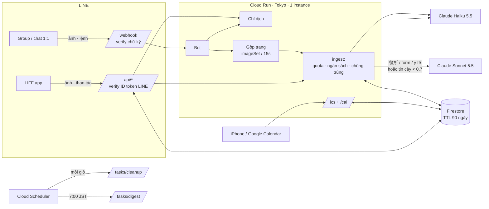
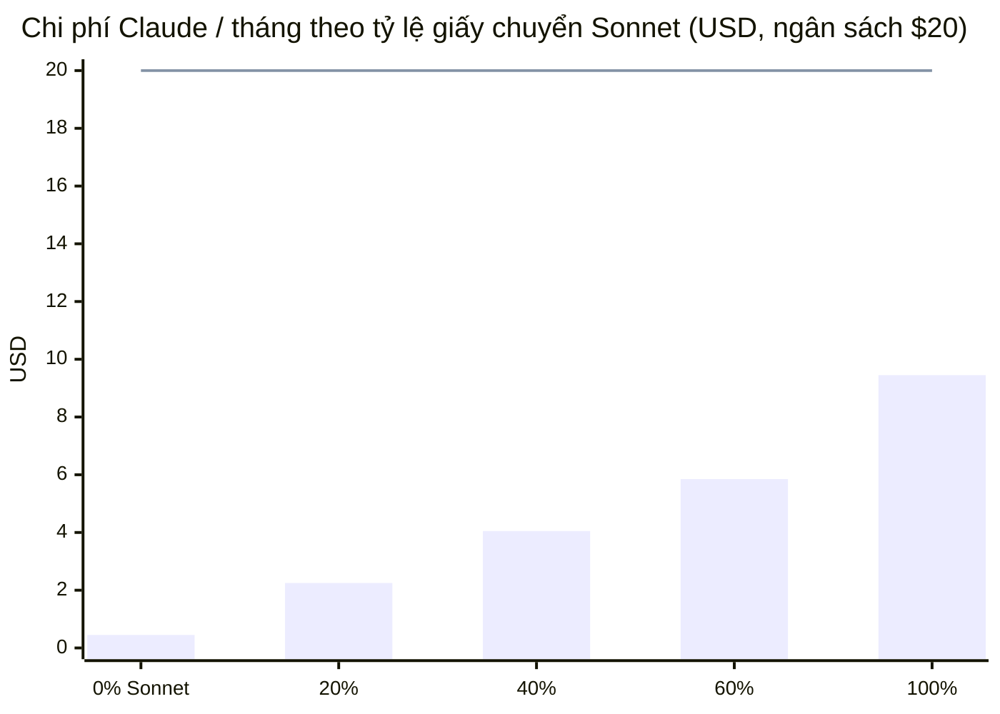

# 🇯🇵 Giấy Tờ Nhật — Trợ lý giấy tờ Nhật cho gia đình Việt (LINE Beta)

Chụp お便り, giấy 役所, form… gửi vào group LINE gia đình → bot trả lời tiếng Việt: **giấy gì, cần làm gì, hạn khi nào, cần chuẩn bị gì**. Hạn & sự kiện tự vào lịch điện thoại. Có chế độ **chỉ dịch** từng dòng. Beta ~20 gia đình, kiểm soát bằng mã mời.

## Tính năng

| Cho gia đình | Cho người vận hành |
|---|---|
| Đọc ảnh/PDF (1–6 trang) → tóm tắt, việc cần làm, hạn, đồ cần mang | Mã mời + giới hạn số gia đình, quota giấy/tháng |
| Lịch điện thoại (iPhone / Google) tự cập nhật, nhắc trước 1 ngày | Ngân sách Claude/tháng, tự dừng khi chạm trần |
| **Chỉ dịch**: dịch từng dòng Nhật → Việt, không lưu | Cảnh báo LINE cho admin: ngân sách 80%/100%, quota push 80%, lỗi tăng đột biến |
| Chống trùng khi nhiều người gửi cùng một giấy | Dashboard admin chỉ có số liệu, **không xem được nội dung** |
| App trong LINE (LIFF): việc sắp tới, giấy tờ, sửa ngày, chụp giấy | CLI: mã mời, gia đình, chi phí (biểu đồ), dọn dữ liệu |
| `/soạn`: soạn tin kính ngữ gửi cô giáo | Test đầy đủ + script deploy/setup chạy lại được |
| Nhắc sáng 7:00 qua LINE (tự chọn bật) | |

## Kiến trúc



| Thành phần | File |
|---|---|
| Lệnh LINE, onboarding, quota/ngân sách, cảnh báo admin, nhắc sáng | `src/server/bot.ts` |
| Đọc giấy bằng Claude, routing Haiku→Sonnet, chi phí | `src/server/extract.ts` |
| Chỉ dịch | `src/server/translate.ts` |
| Chống trùng (hash ảnh · cùng giấy · lịch) | `src/server/dedupe.ts` |
| Gộp ảnh nhiều trang | `src/server/aggregator.ts` |
| Lịch ICS (RFC 5545) + trang "Thêm vào lịch" | `src/server/ics.ts`, `src/server/calendarPage.ts` |
| HTTP routes | `src/server/app.ts` |
| Lưu trữ: Firestore / file JSON (dev) / memory (test) | `src/server/db/*` |
| App LIFF (mobile) | `src/components/mobile/FamilyApp.tsx`, `src/App.tsx` |
| Trang quyền riêng tư (công khai) | `src/components/PrivacyAndGuideView.tsx` |

## Lệnh trong LINE

| Gõ / bấm | Tác dụng |
|---|---|
| *(gửi ảnh/PDF)* | Đọc & thêm lịch. Nhiều ảnh gửi liền nhau = 1 giấy |
| `dịch` rồi gửi ảnh · `dịch <chữ Nhật>` | Chỉ dịch từng dòng (không lưu, không tính quota) |
| `lịch` | Trang "Thêm vào lịch iPhone / Google" |
| `menu`, `?`, `@tên bot` | Hiện các nút bấm (trong group không có rich menu) |
| `/soạn <tiếng Việt>` | Soạn tin kính ngữ gửi cô giáo + dịch ngược |
| `trạng thái` · `đặt tên <tên>` · `nhắc sáng bật/tắt` | Quota · tên gia đình · nhắc 7:00 |
| `xóa dữ liệu` | Xóa toàn bộ (xác nhận trong 5 phút), đổi link lịch |
| `hướng dẫn` · `/whoami` | Trợ giúp · xem userId (để cấu hình admin) |

Trong group, bot **im lặng** với tin nhắn thường. Chat 1:1 có **rich menu** 6 nút (`assets/richmenu.png`).

## Chạy local (không cần LINE/Claude)

```bash
npm install
npm run dev     # http://localhost:3000 — mock Claude, dữ liệu ở .data/dev-db.json
```

Cài đặt → **LINE Test Lab**: Join → Đồng ý → `BETA2026` → gửi giấy mẫu. Đổi người dùng bằng `?dev_user=U_xxx` (`U_admin…` = admin). Có `ANTHROPIC_API_KEY` trong `.env` thì ảnh/PDF thật sẽ được Claude đọc.

## Scripts

> Windows: chạy trong **Git Bash** (không phải PowerShell).

| Lệnh | Dùng khi |
|---|---|
| `npm run check` | typecheck + test + build — chạy trước mỗi lần deploy |
| `npm run try-extract -- a.jpg b.jpg [--json] [--ics]` | Thử đọc giấy thật: reply LINE, model, token, chi phí |
| `PROJECT_ID=... bash scripts/deploy.sh` | Dựng toàn bộ GCP lần đầu (API, SA, Firestore+TTL, secrets, Cloud Run, Scheduler) |
| `PROJECT_ID=... bash scripts/deploy.sh --deploy-only` | Cập nhật code; giữ nguyên LIFF_ID/ADMIN_USER_IDS đã đặt; tạo lại job Scheduler |
| `npx tsx scripts/line-setup.ts <url>` | Gắn webhook, test chữ ký, kiểm tra chế độ Bot, quota push |
| `npx tsx scripts/richmenu.ts` | Cài rich menu (cần `LINE_CHANNEL_ACCESS_TOKEN`, `LIFF_ID`) |
| `npm run data -- inspect <id> [--file x.csv]` · `sync <id>\|--all [--dry-run]` · `diff` · `publish` · `reject` · `rollback` · `status` · `check-links` | Master data (từ điển rác từ dữ liệu mở): xem file nguồn, đồng bộ, duyệt/rollback — xem `docs/design-lens-garbage-grocery.md` §5 |
| `npm run admin -- invite:create DOT1 --max 5` | Tạo mã mời (`invite:list`, `invite:disable`) |
| `npm run admin -- usage` | Biểu đồ chi phí / push / loại giấy / độ chính xác |
| `npm run admin -- families` · `quota <id> <n>` · `cleanup` | Vận hành |

Admin CLI với dữ liệu thật: `STORAGE=firestore GOOGLE_CLOUD_PROJECT=<id>` + `gcloud auth application-default login`.
Lấy token LINE đang dùng mà không cần copy: `export LINE_CHANNEL_ACCESS_TOKEN=$(gcloud secrets versions access latest --secret=line-channel-token)`.

## Deploy production

1. **LINE OA Manager** (trình duyệt máy tính) → Settings: *Account settings* → cho phép tham gia group · *Response settings* → Chat **Off**, Greeting/Auto-response **Off** · *Messaging API* → Enable.
2. **LINE Developers** → channel bot: lấy **Channel secret** (Basic settings) + **Channel access token (long-lived)** (Messaging API).
3. `PROJECT_ID=<id> bash scripts/deploy.sh` — nhập 3 khóa khi được hỏi. Key Anthropic cấp tổ chức (lỗi *"not scoped to a workspace"*): tạo key trong workspace, hoặc thêm `ANTHROPIC_WORKSPACE_ID=wrkspc_…`.
4. `npx tsx scripts/line-setup.ts <url>` → bật **Webhooks** trong Response settings.
5. **LIFF**: Provider → *Create channel* → **LINE Login** (web app) → tab LIFF → Add: Size *Full*, Endpoint = URL Cloud Run, scope `openid profile` → **Publish** channel. Rồi `LIFF_ID=… ADMIN_USER_IDS=U… bash scripts/deploy.sh --deploy-only`.
6. `npx tsx scripts/richmenu.ts` · tạo mã mời · gửi `docs/invite-message.md`.

> Cloud Run `--max-instances=1 --no-cpu-throttling`: webhook trả 200 ngay rồi xử lý nền; gộp trang, chống trùng sự kiện, chế độ dịch nằm trong RAM. Đủ cho 20 gia đình; scale ngang cần Cloud Tasks.

## Chi phí ước tính (20 gia đình × 50 giấy = 1.000 giấy/tháng)

Haiku 5.5 $0.10/$0.50, Sonnet 5.5 $2/$10 per 1M token; giả định 1 trang ≈ 1.500 token vào / 600 ra, giấy chuyển Sonnet đã chạy Haiku trước. Thinking tính như output nên thực tế có thể ~1.5–2× — đo bằng `try-extract`. "Chỉ dịch" ≈ $0.001–0.003/lần.



**LINE push** (200 tin/tháng gói free) chỉ dùng khi: reply token hết hạn, nhắc sáng (tự chọn, giữ lại 20 tin dự phòng), cảnh báo admin. Nhắc hạn chính đi qua **lịch điện thoại**.

## Lịch ICS

- Bot gửi trang `/cal/<token>` (mở ngoài LINE): **Thêm vào lịch iPhone** (`webcal://` → Đăng ký) và **Google Calendar** (chỉ hoạt động ở giao diện máy tính — trang có hướng dẫn). Feed: `/ics/<token 192-bit>.ics`.
- Có giờ → `TZID=Asia/Tokyo`; không giờ → cả ngày. Hạn = sự kiện `[HẠN] …`, ẩn khi tick xong. Ngày không chắc có `[?]`.
- iPhone: VALARM nhắc trước 1 ngày. Google: dùng nhắc mặc định của người dùng, refresh vài giờ/lần.

## Riêng tư

Ảnh không lưu (chỉ RAM; "chỉ dịch" giữ tối đa 10 phút) · nội dung tự xóa sau 90 ngày · `xóa dữ liệu` xóa ngay + đổi link lịch · bot bị xóa khỏi group → xóa sau 7 ngày · mọi truy vấn lọc theo `family_id`, LIFF chỉ cho thành viên group · admin chỉ thấy số liệu. Trang công khai cho gia đình: `/?tab=privacy`.

## Test

```bash
npm test                                                     # tất cả (memory)
gcloud emulators firestore start --host-port=127.0.0.1:8089  # cửa sổ 1 (cần: gcloud components install cloud-firestore-emulator)
FIRESTORE_EMULATOR_HOST=127.0.0.1:8089 npm test              # cửa sổ 2: chạy thêm bộ test hợp đồng cho Firestore
```

## Checklist trước khi mời gia đình

- [ ] `npm run check` xanh
- [ ] `try-extract` với 5–10 giấy thật (お便り, 献立表, 役所, form, giấy khám) — kiểm tra ngày tháng
- [ ] `line-setup` tất cả ✅, rich menu đã cài
- [ ] Group thử: đồng ý → mã mời → gửi ảnh → thêm lịch iPhone & Google → `dịch` → 2 người gửi cùng giấy
- [ ] `xóa dữ liệu` → link lịch cũ trả 404
- [ ] Spend limit trong Anthropic Console · mã mời riêng cho đợt đầu
