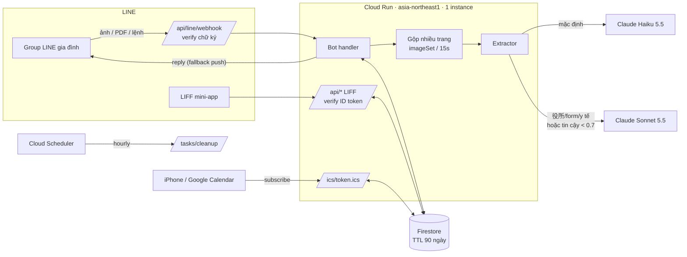
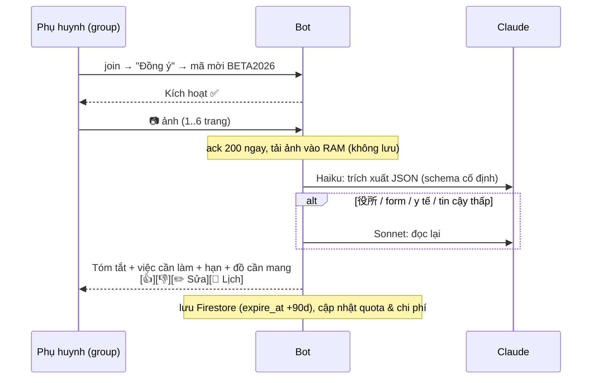
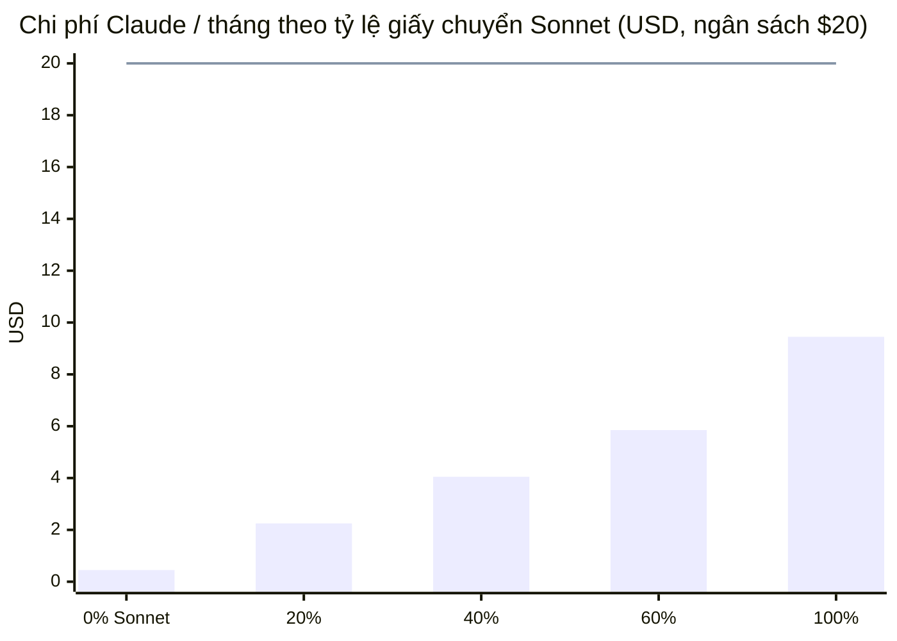

# 🇯🇵 Giấy Tờ Nhật — Trợ lý giấy tờ Nhật cho gia đình Việt (LINE Beta)

Chụp お便り, giấy 役所, form… gửi vào group LINE gia đình → bot trả lời tiếng Việt: **giấy gì, cần làm gì, hạn khi nào, cần chuẩn bị gì**. Hạn & sự kiện tự vào lịch điện thoại qua link ICS bí mật. Beta ~20 gia đình, kiểm soát bằng mã mời.

## Kiến trúc





| Thành phần | File |
|---|---|
| Webhook, lệnh, onboarding, quota/budget | `src/server/bot.ts` |
| Claude extraction + routing Haiku→Sonnet + chi phí | `src/server/extract.ts` |
| Gộp ảnh nhiều trang | `src/server/aggregator.ts` |
| ICS (RFC 5545: TZID, DTEND, folding, VALARM -1 ngày) | `src/server/ics.ts` |
| HTTP routes (LIFF API, admin, ICS, cleanup, dev simulator) | `src/server/app.ts` |
| Lưu trữ: Firestore / file JSON (dev) / memory (test) | `src/server/db/*` |
| LIFF UI (React) | `src/App.tsx`, `src/components/*` |

## Lệnh trong LINE

| Gõ | Tác dụng |
|---|---|
| *(gửi ảnh/PDF)* | Đọc & tóm tắt. Nhiều ảnh gửi liền nhau = 1 giấy (tối đa 6 trang) |
| `lịch` | Link ICS + hướng dẫn iPhone / Google |
| `trạng thái` | Quota tháng này |
| `/soạn <tiếng Việt>` | Soạn tin nhắn kính ngữ gửi cô giáo + dịch ngược |
| `xóa dữ liệu` | Xóa toàn bộ (xác nhận trong 5 phút), đổi link lịch |
| `hướng dẫn`, `/whoami` | Trợ giúp, xem userId (để cấu hình admin) |

Trong group, bot **im lặng** với tin nhắn thường — chỉ trả lời ảnh và lệnh.

## Chạy local (2 phút, không cần LINE/Claude)

```bash
npm install
npm run dev            # http://localhost:3000 — dev mode, mock extractor, lưu .data/dev-db.json
```

Mở tab **LINE Test Lab**: Join → Đồng ý → `BETA2026` → gửi ảnh mẫu. Mọi tin nhắn đi qua đúng bot handler thật; tab Gia đình / Admin đọc dữ liệu thật. Đổi người dùng bằng `?dev_user=U_xxx` (`U_admin...` = admin).

Có `ANTHROPIC_API_KEY` trong `.env` → upload ảnh/PDF thật trong Test Lab sẽ gọi Claude thật.

## Scripts tái sử dụng

| Lệnh | Dùng khi |
|---|---|
| `npm run check` | typecheck + 31 test + build (chạy trước mỗi lần deploy) |
| `npm run try-extract -- a.jpg b.jpg [--json] [--ics]` | Thử pipeline trên giấy thật: in reply LINE, model, token, chi phí |
| `PROJECT_ID=... npm run deploy` | Dựng toàn bộ GCP (API, SA, Firestore+TTL, secrets, Cloud Run, Scheduler) — chạy lại được |
| `npm run line:setup -- https://<url>` | Gắn webhook vào LINE, test chữ ký, kiểm tra chế độ Bot, xem quota push |
| `npm run admin -- invite:create KANTO --max 10` | Tạo mã mời (cũng: `invite:list`, `invite:disable`) |
| `npm run admin -- usage` | Biểu đồ chi phí / push / loại giấy / độ chính xác trong tháng |
| `npm run admin -- families` · `quota <id> <n>` · `cleanup` | Vận hành |

Admin CLI dùng `STORAGE=firestore` + `gcloud auth application-default login` để thao tác dữ liệu production.

## Deploy production

1. **LINE Developers**: tạo Messaging API channel → lấy *Channel secret* + *access token*. Trong LINE OA Manager: Response mode = **Bot**, tắt Auto-response, bật Webhook, cho phép bot **tham gia group**.
2. **Deploy**:
   ```bash
   export PROJECT_ID=... LINE_CHANNEL_SECRET=... LINE_CHANNEL_ACCESS_TOKEN=... ANTHROPIC_API_KEY=...
   npm run deploy
   ```
3. **LIFF**: tạo LINE Login channel (cùng provider) → LIFF app, Size *Full*, Endpoint = URL Cloud Run, scope `openid profile`. Rồi:
   ```bash
   LIFF_ID=1234567890-abcd ADMIN_USER_IDS=Uxxxx npm run deploy -- --deploy-only
   ```
   (`ADMIN_USER_IDS`: gửi `/whoami` cho bot để lấy.)
4. `npm run line:setup -- https://<url>` → tất cả ✅.
5. `npm run admin -- invite:create BETA2026 --max 20` (với `STORAGE=firestore`).

> Cloud Run chạy `--max-instances=1 --no-cpu-throttling`: webhook trả 200 ngay rồi đọc ảnh nền; bộ gộp trang và chống trùng sự kiện nằm trong RAM. Đủ cho 20 gia đình; muốn scale ngang cần chuyển sang Cloud Tasks.

## Chi phí ước tính (20 gia đình × 50 giấy = 1.000 giấy/tháng)

Giá: Haiku 5.5 $0.10/$0.50, Sonnet 5.5 $2/$10 per 1M token. Giả định 1 trang ≈ 1.500 token vào / 600 ra; giấy chuyển Sonnet đã chạy Haiku trước (tính cả hai). Token suy luận (thinking) tính như output nên thực tế có thể cao hơn ~1.5–2× — đo bằng `try-extract` trên giấy thật.



Bot tự dừng đọc khi chi phí tháng chạm `MONTHLY_BUDGET_USD` (mặc định $20). Theo dõi thực tế: `npm run admin -- usage` hoặc tab Admin.

LINE push (giới hạn 200/tháng gói free) chỉ dùng khi reply token hết hạn hoặc khi bấm "Khẩn cấp"; nhắc hạn đi qua **lịch điện thoại** (VALARM), không tốn push.

## Lịch ICS

- Bot gửi trang `https://<url>/cal/<token>` (mở ngoài LINE): nút **Thêm vào lịch iPhone** (`webcal://` → hộp thoại Đăng ký) và **Thêm vào Google Calendar**. Feed thật là `https://<url>/ics/<token 192-bit>.ics`, đổi được bất cứ lúc nào (LIFF → Đồng bộ ICS → Rotate) và tự đổi khi xóa dữ liệu.
- Sự kiện có giờ → `DTSTART;TZID=Asia/Tokyo`, không giờ → cả ngày. Hạn nộp = sự kiện cả ngày `[HẠN] …`, ẩn khi đã tick xong.
- Ngày bot không chắc (giấy thiếu năm…) có tiền tố `[?]` — sửa trong LIFF (✏️) là lịch cập nhật ngay.
- **iPhone** tôn trọng VALARM nhắc trước 1 ngày. **Google Calendar** bỏ qua VALARM của lịch đăng ký và dùng thông báo mặc định của người dùng; Google cũng chỉ refresh lịch đăng ký vài giờ một lần.

## Riêng tư

- Ảnh chỉ nằm trong RAM khi đọc, **không lưu**. Nội dung đã đọc có `expire_at` = +90 ngày (Firestore TTL + cleanup job).
- Mọi truy vấn tài liệu lọc theo `family_id`; LIFF API xác thực **ID token LINE** và chỉ cho thành viên của group đó truy cập.
- Admin chỉ thấy số liệu (số giấy theo loại, chi phí, 👍/👎, lỗi không kèm nội dung) — không có API xem nội dung giấy hay link lịch.
- Bot bị kick khỏi group → dữ liệu bị xóa sau 7 ngày (vào lại trong 7 ngày thì giữ nguyên).
- `xóa dữ liệu` / nút trong LIFF → xóa ngay, thu hồi link lịch, phải đồng ý + nhập mã lại.

## Checklist trước khi mời gia đình

- [ ] `npm run check` xanh
- [ ] `npm run try-extract` với 5–10 giấy thật (お便り, 献立表, 役所, form, giấy khám) — đọc kỹ ngày tháng
- [ ] `npm run line:setup` tất cả ✅ (chatMode = bot)
- [ ] Thêm bot vào group thử → join → đồng ý → mã mời → gửi ảnh → subscribe link lịch trên iPhone và Google
- [ ] Thử `xóa dữ liệu` → link lịch cũ trả 404
- [ ] Tạo mã mời thật, đặt cảnh báo ngân sách trong Anthropic Console
