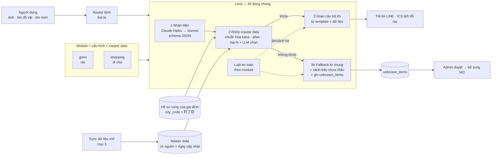
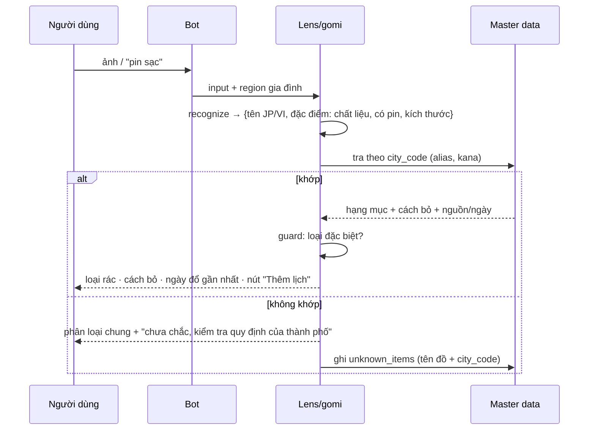
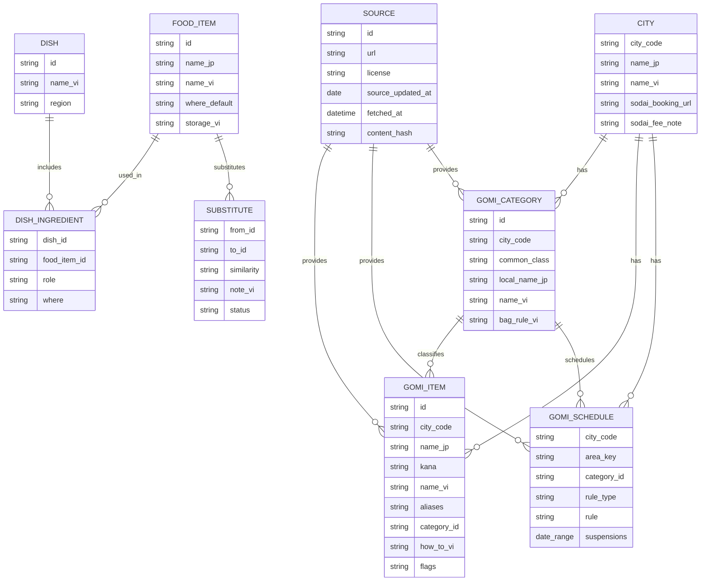
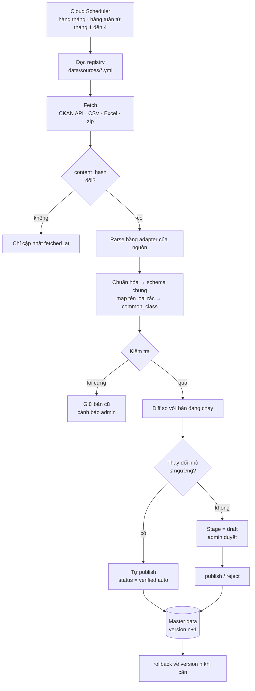
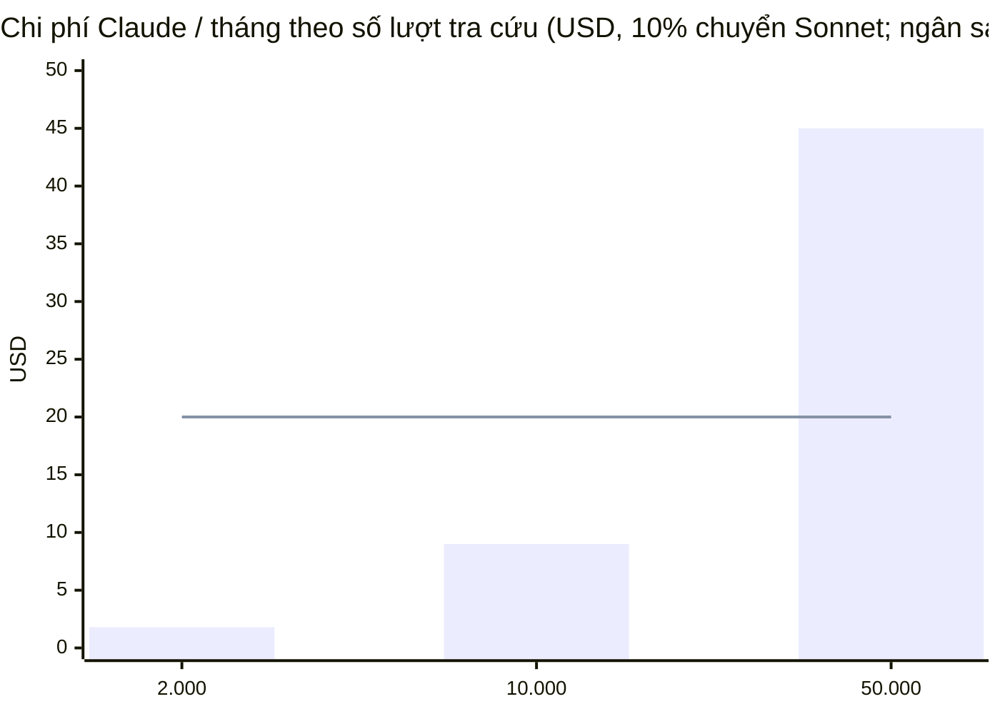
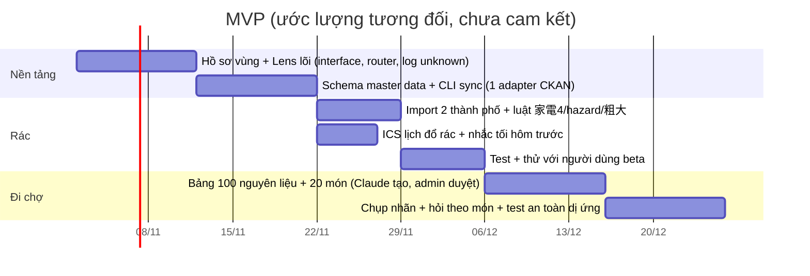

# Thiết kế: bộ "đọc ảnh" dùng chung (Lens) + 2 module Phân loại rác / Đi chợ Nhật

> Trạng thái: **thiết kế, chưa code**. Ngày: 2026-10-28.
> Phần "đã kiểm chứng" / "chưa kiểm chứng" ghi rõ ở mục 8. Những gì thuộc buổi thảo luận trước ("schema chung như đã bàn", "bản tin chính sách") **không có trong repo** nên được thiết kế lại từ đầu ở đây — cần đối chiếu.

## 1. Nguyên tắc

| # | Nguyên tắc | Hệ quả |
|---|---|---|
| 1 | **AI nhận diện, master data quyết định** | Khi khớp master data, câu trả lời lấy từ dữ liệu (có nguồn + ngày), không để LLM tự viết luật. Giảm bịa. |
| 2 | Một lõi, nhiều module | Module chỉ khai báo: prompt nhận diện, schema, matcher, composer, luật an toàn. |
| 3 | Không biết thì nói không biết | Không khớp → AI phân loại chung + cảnh báo + ghi log cho admin. |
| 4 | Không tốn quota LINE | Trả lời bằng reply; nhắc lịch qua ICS (app lịch của điện thoại). |
| 5 | Không lưu ảnh | Giống hiện tại: ảnh chỉ ở RAM. Log "chưa biết" chỉ lưu tên đồ + mã thành phố. |

## 2. Kiến trúc



### Giao diện module (TypeScript, đặt ở `src/server/lens/`)

```ts
interface LensModule<Q, M> {
  id: 'gomi' | 'shopping';
  recognize(input: LensInput, ctx: Ctx): Promise<Q>;     // ảnh/chữ → truy vấn có cấu trúc (1 lần gọi Claude)
  match(q: Q, ctx: Ctx): Promise<Match<M>[]>;            // tra master data, trả điểm tin cậy
  compose(m: Match<M>, ctx: Ctx): LineMessage[];         // template, không dùng LLM tự do
  fallback(q: Q, ctx: Ctx): Promise<LineMessage[]>;      // không khớp: AI chung + disclaimer + log
  guard(q: Q, m: Match<M> | null): Guard;                // luật an toàn: 'allow' | 'warn' | 'refuse'
}
```

Tái dùng từ code hiện có: `pageBlock`, `createAnthropicClient`, `calculateCostUsd`, routing Haiku→Sonnet (`extract.ts`), hàng đợi gộp ảnh (`aggregator.ts`), ngân sách/cảnh báo admin (`bot.ts`), ICS (`ics.ts`). Mới: thư mục `lens/`, bảng master data, hồ sơ vùng.

### Hồ sơ vùng dùng chung

`Family` hiện chưa có địa chỉ. Thêm:

```ts
region?: { city_code: string /* JIS 5 số */; chome_code?: string; label_vi: string; set_at: string }
```

- Chỉ lưu **thành phố + 町丁目**, không lưu số nhà. Hỏi **một lần** (gõ tên khu / chọn từ danh sách / gửi vị trí), module bản tin chính sách và rác cùng đọc.
- `xóa dữ liệu` xóa luôn `region`.
- Danh sách 町丁目 chuẩn: lấy từ *大字・町丁目レベル位置参照情報* (MLIT, cung cấp miễn phí). Điều khoản dùng cần xác nhận lại trước khi nhúng (mục 8).

## 3. Module Phân loại rác

### Luồng



### Bảng xử lý ca đặc biệt (`guard`)

| Nhóm | Nhận biết | Trả lời | Dữ liệu cần theo thành phố |
|---|---|---|---|
| 粗大ごみ | `size_cm` > ngưỡng của thành phố hoặc hạng mục ghi `sodai` | Phải **đặt lịch trước + mua tem**; link đặt lịch; mức phí | `sodai_fee_yen`, `booking_url`, `phone`, `fee_source` |
| 家電4品目 (テレビ, 冷蔵庫・冷凍庫, 洗濯機・乾燥機, エアコン) | Nhóm cố định theo luật, **không phụ thuộc thành phố** | **Không bỏ như rác thường.** Giải thích 4 cách: nhờ cửa hàng đã mua · cửa hàng mới khi mua thay · gọi 家電リサイクル受付センター · tự mang tới 指定引取場所 (trả phí tại bưu điện, dán 家電リサイクル券). Cảnh báo xe thu gom rác không phép | `kaden_center_url` (chung toàn quốc) |
| Pin, bình xịt, bật lửa, pin sạc/mobile battery | `hazard: true` hoặc từ khóa | Cảnh báo **cháy nổ**; cách bỏ riêng của thành phố (điểm thu gom, ngày riêng, túi trong) | `hazard_rule_vi`, `hazard_source` |
| Máy tính (PC) | nhóm cố định | Hướng dẫn thu hồi theo luật PC (chưa đưa vào MVP, ghi `unsupported` + link) | — |
| Không có trong dữ liệu | `match = null` | AI phân loại chung + `⚠️ chưa chắc` + log | — |

Quy tắc đặt tên: danh sách "luật quốc gia" (家電4品目, hazard chung) nằm trong **code/dữ liệu chung**, không lẫn vào dữ liệu từng thành phố, để thành phố thiếu dòng vẫn không bao giờ trả lời "bỏ rác thường" cho một cái tivi.

### Lịch đổ rác → ICS

- Feed **riêng** `/ics/<token>/gomi.ics` (không trộn với lịch giấy tờ, tránh nhiễu). Cùng cơ chế token 192-bit hiện có.
- Mô hình luật đổ rác (3 dạng, vì dữ liệu mở của thành phố khác nhau):

| Dạng | Ví dụ nguồn | ICS |
|---|---|---|
| `weekly` (thứ 2, 5 hàng tuần) | bảng "収集曜日" theo 町丁目 | `RRULE:FREQ=WEEKLY;BYDAY=MO,TH` |
| `nth` (thứ 4 tuần 2 & 4) | thành phố ghi "第2・4水曜" | `RRULE:FREQ=MONTHLY;BYDAY=2WE,4WE` |
| `dates` (liệt kê ngày) | lịch Excel theo từng 町丁目 | `RDATE;VALUE=DATE:…` |

- Ngày nghỉ (năm mới…) → `EXDATE` theo dữ liệu thành phố.
- **Nhắc tối hôm trước**: sự kiện cả ngày + `VALARM TRIGGER:-PT4H` (≈20:00 hôm trước). iPhone nhận VALARM; Google dùng nhắc mặc định (đã ghi ở README mục Lịch ICS).
- Mỗi sự kiện có nhãn loại rác + tên tiếng Việt, mô tả có "dữ liệu cập nhật ngày …".

## 4. Module Đi chợ Nhật

| Chức năng | Nhận diện | Trả lời (nguồn) |
|---|---|---|
| Chụp nhãn | `product_name_jp`, loại, `bbd_type` (賞味/消費), `bbd_date`, `storage_text`, `allergen_text_verbatim` | Sản phẩm là gì · nấu món gì · bảo quản (từ master data + nhãn) · thẻ giải thích 賞味期限 vs 消費期限 (nội dung tĩnh, không qua LLM) |
| Hỏi theo món | `dish_name` | `dish` → danh sách nguyên liệu, mỗi dòng có `where`: `supermarket` / `asian_store` / `vn_store` / `online` |
| Đồ thay thế | `ingredient_vn` | `substitute` kèm độ giống vị, ghi chú, **mức tin cậy + trạng thái duyệt** |

### An toàn (bắt buộc, kiểm tra bằng test)

1. **Dị ứng**: composer chỉ **trích nguyên văn** mục アレルギー表示 trong khung riêng + câu "Hãy tự kiểm tra lại trên nhãn". Schema không có trường "an toàn / không an toàn"; test chặn các cụm "an toàn với bạn", "không chứa" trong output.
2. **Thuốc** (drugstore, 医薬品, 第◯類医薬品): `guard = refuse` — không đọc liều, khuyên hỏi 薬剤師. Ngoài MVP.
3. **Hạn dùng**: 消費期限 quá hạn → nói rõ "đừng ăn"; 賞味期限 quá hạn → chỉ nói đây là hạn "ngon nhất", không khẳng định ăn được. Không đoán nếu ngày bị mờ (`warnings_vi`).
4. **Quảng cáo/affiliate**: gợi ý "mua ở đâu" có merchant trả phí phải **ghi rõ "PR/quảng cáo"** (quy định ステマ có hiệu lực từ 10/2023) và tách khỏi gợi ý trung lập.

## 5. Master data & cơ chế sync

### Schema chung (rút gọn)



**Cột bắt buộc ở mọi bảng master data** (importer từ chối nếu thiếu):

| Cột | Ý nghĩa |
|---|---|
| `source_id`, `source_url` | Dòng này đến từ đâu |
| `source_updated_at` | Ngày nguồn cập nhật |
| `fetched_at`, `content_hash` | Lấy lúc nào, để biết có đổi không |
| `status` | `draft` → `verified` → `stale` / `retired` |
| `verified_by`, `verified_at` | Ai duyệt (hoặc `auto` nếu qua kiểm tra tự động) |
| `license` | Điều kiện dùng lại (CC BY → phải ghi nguồn trong câu trả lời) |

`common_class` là phân loại chung toàn quốc để so sánh/giải thích nhất quán, còn `local_name_jp` giữ đúng tên thành phố gọi (ví dụ "燃やすごみ" ở nơi này, "もえるごみ" ở nơi khác):
`burnable · non_burnable · plastic · pet · can · glass · paper · cloth · hazardous · sodai · kaden4 · pc · not_collected`.

### Pipeline sync



**Kiểm tra (V)**: đủ cột bắt buộc · số dòng lệch > 20% so với bản trước → dừng · tên loại rác lạ chưa có trong bản đồ `common_class` → dừng · lịch có `area_key` không tồn tại trong danh sách 町丁目 → cảnh báo · URL nguồn còn sống · mọi hạng mục `kaden4`/`hazardous` không bị đổi sang loại thường (luật an toàn).

**Registry nguồn** (một file một nguồn, thêm thành phố = thêm file, không sửa code lõi):

```yaml
# data/sources/<city_code>-<dataset>.yml
id: city-xxxxx-items
city_code: "xxxxx"
kind: gomi_items          # gomi_items | gomi_schedule | sodai_fee
url: https://…            # trang dataset (CKAN) hoặc file trực tiếp
format: csv               # csv | xlsx | zip | ckan
encoding: shift_jis       # nhiều CSV của thành phố là Shift_JIS
license: CC-BY-4.0
attribution: "…"
cadence: monthly          # hoặc weekly_jan_apr
adapter: ckan_csv_v1      # adapter dùng lại cho nhiều thành phố cùng định dạng
columns: { name_jp: 品目, category: 区分, note: 備考 }
category_map: { 燃やすごみ: burnable, … }
```

**CLI dùng lại** (đặt ở `scripts/data.ts`, giống phong cách `admin.ts`):

| Lệnh | Việc |
|---|---|
| `npm run data -- sync <source-id>\|--all [--dry-run]` | Chạy pipeline; `--dry-run` chỉ in diff |
| `npm run data -- diff <source-id>` | Xem thay đổi đang chờ duyệt |
| `npm run data -- publish <source-id>` · `reject` · `rollback` | Duyệt / từ chối / quay lại version trước |
| `npm run data -- status` | Biểu đồ chữ: nguồn nào mới/cũ/lỗi, số dòng verified vs draft |
| `npm run data -- unknown [--top 30]` | Đồ hay bị hỏi mà chưa có dữ liệu (đầu vào cho admin) |
| `npm run data -- check-links` | Kiểm tra URL nguồn và link đặt lịch 粗大ごみ |

- **Chạy ở đâu**: Cloud Run job/Scheduler (như `/tasks/cleanup`), không chạy trong request của người dùng.
- **Dữ liệu cũ (stale)**: lịch đổ rác gắn năm tài chính (thành phố thường công bố lịch năm sau vào khoảng tháng 1–3 → tăng tần suất sync ở giai đoạn này). Dữ liệu > 13 tháng không cập nhật → `stale` → câu trả lời tự thêm "dữ liệu cũ, kiểm tra lại".
- **Alert**: tái dùng kênh cảnh báo LINE cho admin (chỉ gửi khi sync lỗi hoặc diff lớn cần duyệt).
- **Hiển thị**: mỗi câu trả lời có dòng nhỏ "Nguồn: <thành phố>, cập nhật <ngày>" (đồng thời đáp ứng yêu cầu ghi nguồn của CC BY).

### Quy trình Claude tạo bản đầu + admin duyệt (cho Đi chợ và alias rác)

`Claude tạo draft (kèm lý do, mức chắc chắn)` → `admin duyệt trong CLI/LIFF admin` → `verified` → nút "gợi ý món thay thế khác" của người dùng sinh `draft` mới với `status=community` (không hiển thị cho đến khi admin duyệt).

## 6. Chi phí

Một lượt tra cứu ≈ 1 ảnh (≈1.500 token vào) + ≈300 token ra. Haiku 5.5: ≈ **$0,0003**; Sonnet chỉ khi Haiku không chắc (giả định 10%) → trung bình ≈ **$0,0009/lượt**. (Chưa tính thinking, README đã lưu ý có thể 1,5–2×; cần đo thực tế bằng script thử như `try-extract`.)



- Lượt tra cứu **không trừ quota "giấy/tháng"**; dùng bộ đếm riêng (`lookup_used`, đề xuất 60/tháng/gia đình để beta) nhưng **cùng ngân sách Claude** và cùng cơ chế tự dừng ở trần.
- Tra cứu bằng **chữ** không cần ảnh → rẻ hơn; khuyến khích trong UI.
- Đồ đã khớp chính xác theo tên (kana/alias) có thể **bỏ qua bước LLM** (tra thẳng master data) → gần 0 chi phí.

## 7. Kiếm tiền & MVP

### B2B 管理会社 (rác)

- Giá trị: giảm khiếu nại "bỏ rác sai" từ người thuê nước ngoài; gửi kèm hướng dẫn khi vào ở.
- Cơ chế: mỗi bất động sản có `property_code` → link/QR LINE → tự điền `region` (city + 町丁目) cho người thuê, không phải hỏi lại. Báo cáo cho công ty chỉ ở mức tổng hợp ẩn danh (đồ hay hỏi nhất theo tòa nhà), **không** theo người thuê.
- **Chưa có số liệu để định giá.** Cần xác nhận trước: 5 cuộc phỏng vấn 管理会社, thử một tòa nhà. Không đặt giá khi chưa kiểm chứng.

### Đi chợ

- Viral Facebook kéo người dùng về; tiệm đồ Việt/shop online trả phí quảng cáo/affiliate (gắn nhãn PR).
- Bảng đối chiếu Việt↔Nhật là tài sản riêng; quy trình duyệt nằm ở mục 5.

### Lộ trình MVP



Rác làm trước vì dữ liệu có sẵn từ nguồn mở, rủi ro pháp lý thấp hơn đi chợ (dị ứng), và dùng chung lõi để chạy thử Lens.

## 8. Kết quả research (28/10/2026)

**Môi trường phiên này chặn truy cập tới trang của các thành phố** (`getaddrinfo ENOTFOUND` với `catalog.data.metro.tokyo.lg.jp`, `www.city.yokohama.lg.jp`, `www.city.kobe.lg.jp`). Vì vậy **chưa tải được dữ liệu thật**; phần dưới là danh sách nguồn từ kết quả tìm kiếm, **chưa mở từng dataset để xác nhận cột/giấy phép/ngày**. Khi cần tải thử, cần cho phép các host này trong cài đặt mạng của môi trường (đọc trang `environment.network`).

### Nguồn dữ liệu mở ứng viên

| Khu vực | Loại | Định dạng / giấy phép (theo kết quả tìm kiếm) | Liên kết |
|---|---|---|---|
| Tỉnh Ishikawa (các thị xã) | Danh mục phân loại + lịch theo địa chỉ | CSV, CC BY; có data dictionary | [ごみ分別品目一覧](https://ckan.opendata.pref.ishikawa.lg.jp/en/dataset/172065_gomibunbetu/resource/5704ec35-a26c-474a-a722-0cdcdb27f22d) · [recycle_calendar](https://ckan.opendata.pref.ishikawa.lg.jp/en/dataset/173614_recycle_calendar/resource/3949fc87-319d-459a-9e0c-e7746eb80fe4) |
| 荒川区 | Danh mục phân loại | CSV, CC BY | [ごみと資源の分別品目](https://catalog.data.metro.tokyo.lg.jp/zh_Hant_TW/dataset/t131181d0000000002/resource/4b0d4ed6-d9a0-46f5-929a-eeb17ca4e136) |
| 中野区 | Thứ đổ rác theo khu | CSV | [catalog Tokyo](https://catalog.data.metro.tokyo.lg.jp/zh_Hans_CN/dataset/t131148d0000000135/resource/2372d8ea-1d6c-4df0-b4a8-b92fabafc331) |
| 東村山市 / 西東京市 | Danh mục phân loại | CSV, CC BY | [東村山](https://catalog.data.metro.tokyo.lg.jp/dataset/t132292d3000000001/resource/7cc48e8b-b837-4384-a3e8-542998ae4162) · [西東京](https://catalog.data.metro.tokyo.lg.jp/zh_Hant_TW/dataset/t132136d3000000001/resource/3f18c688-c091-4252-87d5-011eacd37862) |
| 神戸市 | Danh mục + ngày đổ theo địa chỉ | Excel, CC BY 2.1 JP | [神戸市 ごみ オープンデータ](https://www.city.kobe.lg.jp/a04164/kurashi/recycle/gomi/shisaku/opendeta.html) |
| 横浜市 | Trang open data về rác | chưa xác nhận | [横浜市](https://www.city.yokohama.lg.jp/city-info/yokohamashi/tokei-chosa/portal/opendata/gomi.html) |
| 広島市 | Lịch theo 町丁目 | Excel theo khu (bản 令和8年度) | [広島市](https://www.city.hiroshima.lg.jp/living/gomi-kankyo/1021277/1003072/1036671/1048041/1048070/1048071.html) |
| 長野市 | Lịch theo "số lịch" + bảng địa chỉ → số lịch | zip theo năm | [長野市](https://www.city.nagano.nagano.jp/n023500/contents/p006280.html) |
| 長崎市 | Thứ đổ theo 町 | Excel/PDF | [長崎市](https://www.city.nagasaki.lg.jp/shimin/140000/142000/p023561.html) |
| 浜松市 | Phân loại theo hạng mục | không rõ có CC BY | [浜松市](https://www.city.hamamatsu.shizuoka.jp/ippai/opendata.html) |
| Toàn quốc | 家電4品目 (luật) | trang hướng dẫn của thành phố/bộ | ví dụ [板橋区](https://www.city.itabashi.tokyo.jp/tetsuduki/gomi/kaden/1001875.html) · [静岡市](https://www.city.shizuoka.lg.jp/gomi/s000683.html) |
| Toàn quốc | Danh sách 町丁目 + toạ độ | MLIT, miễn phí | [MLIT ISJ](https://wiki.openstreetmap.org/wiki/JA:MLIT_ISJ) (điều khoản gốc cần xác nhận) |

### Phát hiện quan trọng

1. **Không có chuẩn quốc gia** cho dữ liệu rác: bộ "自治体標準オープンデータセット" của Digital Agency liệt kê công trình công cộng, AED, cơ sở y tế, sự kiện, toilet công cộng… **không thấy** mục rác. Mỗi nơi một định dạng → bắt buộc có adapter theo nguồn + bước chuẩn hóa `common_class` (mục 5).
2. **Độ chi tiết khác nhau**: có nơi theo 町丁目 (Hiroshima, Nagasaki), có nơi theo "số lịch" (Nagano), có nơi theo tên khu đại tự (Ishikawa), có nơi liệt kê ngày (Excel lịch). Vì thế mô hình lịch có 3 dạng `weekly / nth / dates` và khoá `area_key` riêng cho từng thành phố.
3. **Định dạng**: Excel/PDF chiếm tỷ lệ đáng kể → adapter Excel cần có; PDF chỉ làm thủ công/`draft`.
4. **Luật 家電4品目** là luật quốc gia, các thành phố đều hướng dẫn giống nhau: 4 loại (エアコン, テレビ, 冷蔵庫・冷凍庫, 洗濯機・衣類乾燥機), không thu gom như rác thường, 4 cách xử lý, trả phí tại bưu điện bằng 家電リサイクル券. Phí phụ thuộc hãng/kích cỡ → không đưa số tiền vào dữ liệu, chỉ trả link tra phí.
5. Toàn quốc 2025: ~4,125 triệu người nước ngoài, người Việt ~681 nghìn (đứng thứ 2) theo báo chí/ISA.

### Việc cần bạn quyết / chưa kiểm chứng

| # | Việc | Ai |
|---|---|---|
| 1 | **Chọn 1–2 thành phố cho MVP**: tìm kiếm không ra số người Việt theo thành phố. Lấy từ *在留外国人統計* (ISA / e-Stat, bảng 市区町村別・国籍別) rồi giao với danh sách có dữ liệu mở ở trên | Bạn (hoặc cho phép mạng để mình lấy) |
| 2 | Mở từng dataset ứng viên, xác nhận **cột, giấy phép, ngày cập nhật** | Mình, sau khi host được cho phép |
| 3 | Xác nhận điều khoản dùng dữ liệu MLIT (町丁目) | Bạn/mình |
| 4 | Đối chiếu "schema chung như đã bàn" và "bản tin chính sách" (không có trong repo) | Bạn |
| 5 | Phỏng vấn 管理会社 trước khi định giá B2B | Bạn |

## 9. Rủi ro

| Rủi ro | Mức | Giảm thiểu |
|---|---|---|
| Trả lời sai loại rác → bị phạt/khiếu nại | Cao | Master data có nguồn + ngày; fallback ghi "chưa chắc"; câu trả lời có link thành phố |
| Nhận nhầm 家電4品目 là rác thường | Cao | Luật quốc gia nằm ngoài dữ liệu thành phố; test bắt buộc |
| Dị ứng: người dùng hiểu "app nói an toàn" | Cao | Chỉ trích nguyên văn nhãn; test chặn câu khẳng định |
| Dữ liệu cũ (đổi lịch năm tài chính) | Trung bình | Sync tăng tần suất tháng 1–4; `stale` sau 13 tháng; hiển thị ngày cập nhật |
| Nguồn đổi định dạng làm hỏng import | Trung bình | Kiểm tra số dòng/loại lạ → giữ bản cũ + cảnh báo |
| Giấy phép dữ liệu (CC BY cần ghi nguồn) | Trung bình | Cột `license`/`attribution` bắt buộc; dòng "Nguồn" trong mọi câu trả lời |
| Chi phí Claude vượt ngân sách | Thấp | Bộ đếm riêng, ngân sách chung, tra thẳng master data khi khớp tên |
| Địa chỉ là dữ liệu cá nhân | Trung bình | Chỉ 町丁目; xoá cùng `xóa dữ liệu`; không đưa vào log |
