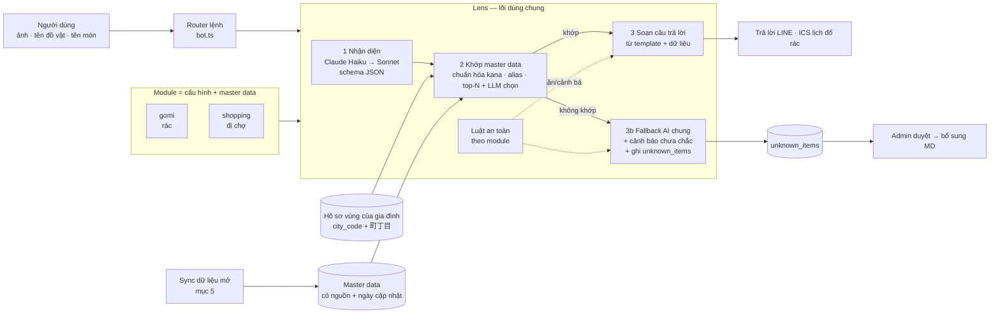
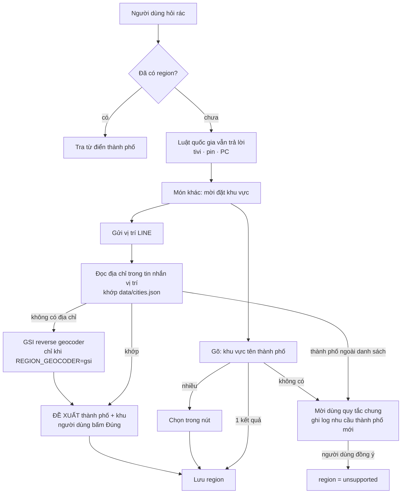
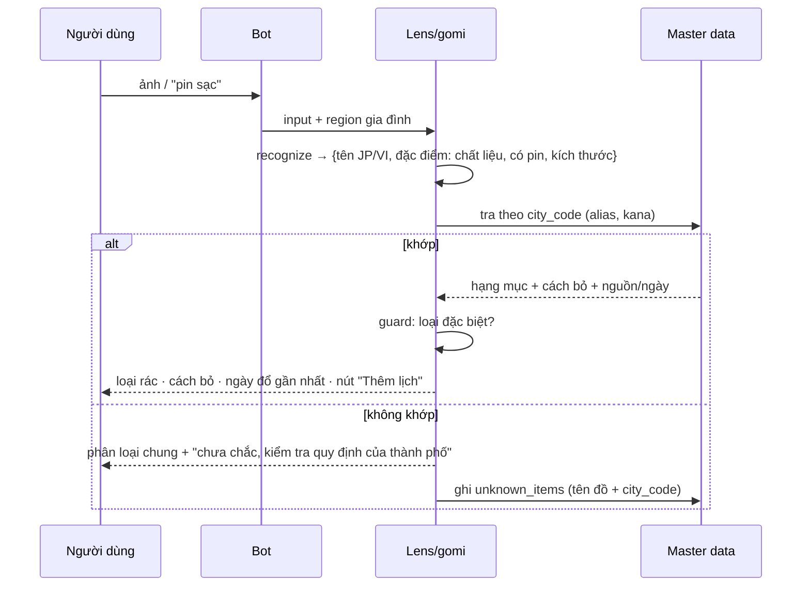
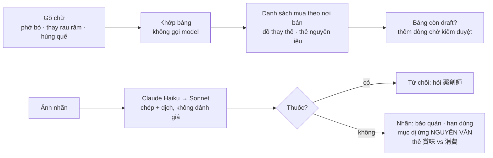
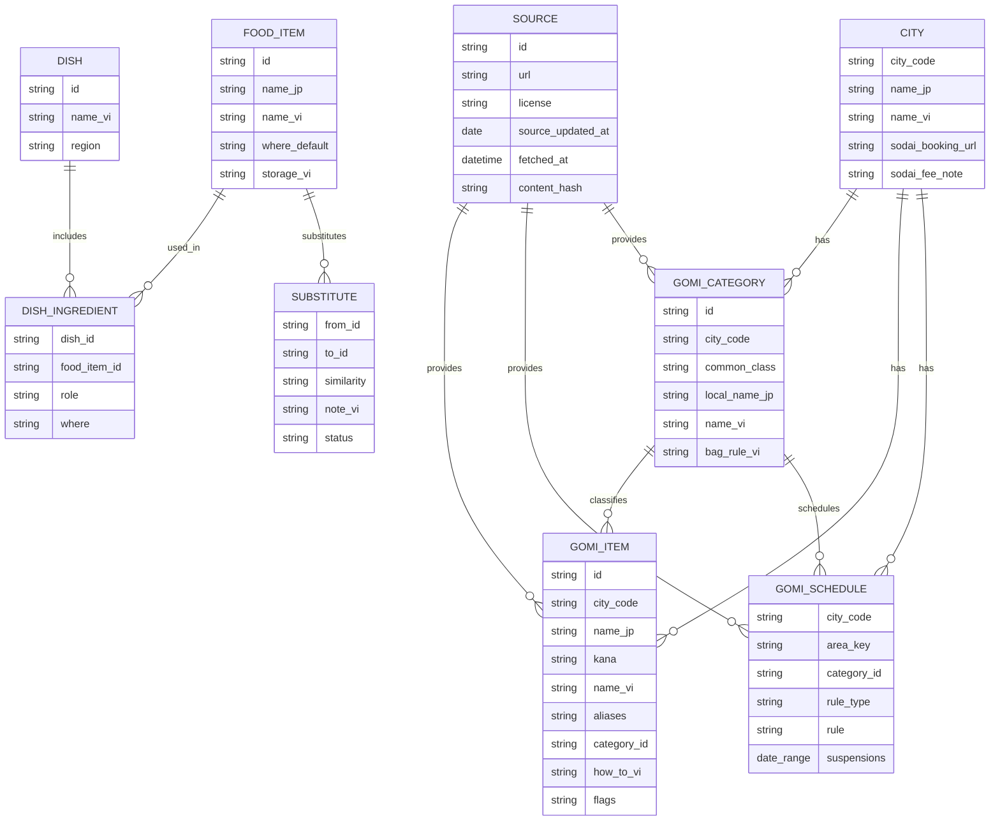
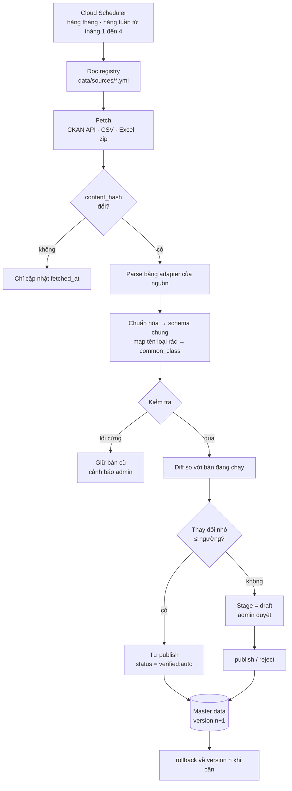
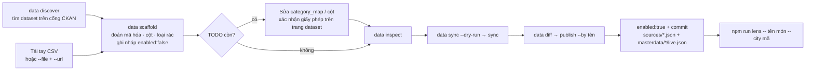
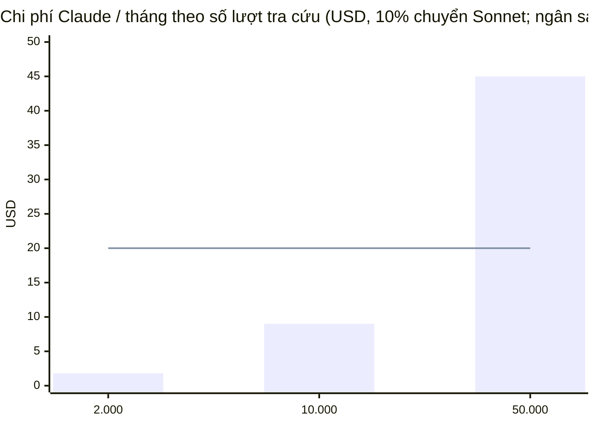
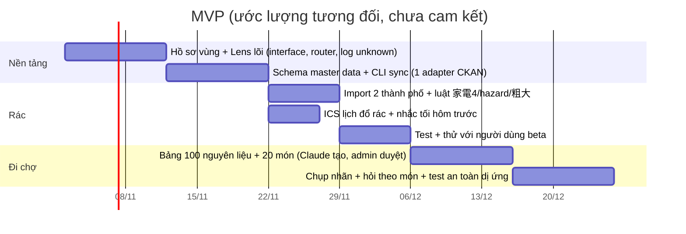

# Thiết kế: bộ "đọc ảnh" dùng chung (Lens) + 2 module Phân loại rác / Đi chợ Nhật

> Trạng thái: thiết kế + đã cài đặt phần rác. **Đã có**: sync master data cho cả 2 loại (`gomi_items` qua `ckan_csv_v1`, `gomi_schedule` qua `schedule_csv_v1`; `scripts/data.ts`); lõi Lens cho rác (`src/server/lens/gomi/`); bot LINE (`rác`, chế độ ảnh, `khu vực [町丁目]`, vị trí LINE → đề xuất → xác nhận, `lịch rác`); `Family.region`; lượt hỏi riêng (`LOOKUP_QUOTA`); log món chưa có; **lịch đổ rác**: đọc "月・木 / 第2・4水", ngày đổ gần nhất trong câu trả lời, feed ICS riêng có nhắc 20:00 tối hôm trước, EXDATE theo ngày nghỉ thành phố công bố; `data/city-info.json` (link/phí 粗大ごみ, bắt buộc có nguồn + ngày). **Đi chợ (MVP) đã có**: `src/server/lens/grocery/*`, bảng `data/grocery/*.json` (109 nguyên liệu, 20 món, 43 nhóm đồ thay thế — **Claude soạn, tất cả còn `draft` chờ admin duyệt**), đọc nhãn bằng Claude, `scripts/grocery.ts`, lệnh `đi chợ`. **Chưa có**: nguồn dữ liệu thật đã bật (`data/sources/` mới có `_template.json`, `data/city-info.json` đang rỗng), adapter Excel, nút "gợi ý món thay thế khác" của cộng đồng, quảng cáo/affiliate, lịch dạng liệt kê ngày (`dates`), store Firestore cho master data. Dữ liệu đã `publish` nằm ở `data/masterdata/<nguồn>/live.json`, commit vào git và đi cùng image. Ngày: 2026-10-28.
> Phần "đã kiểm chứng" / "chưa kiểm chứng" ghi rõ ở mục 8. Những gì thuộc buổi thảo luận trước ("schema chung như đã bàn", "bản tin chính sách") **không có trong repo** nên được thiết kế lại từ đầu ở đây — cần đối chiếu.

## 1. Nguyên tắc

| # | Nguyên tắc | Hệ quả |
|---|---|---|
| 1 | **AI nhận diện, master data quyết định** | Khi khớp master data, câu trả lời lấy từ dữ liệu (có nguồn + ngày), không để LLM tự viết luật. Giảm bịa. |
| 2 | Một lõi, nhiều module | Module chỉ khai báo: prompt nhận diện, schema, matcher, composer, luật an toàn. |
| 3 | Không biết thì nói không biết | Không khớp → AI phân loại chung + cảnh báo + ghi log cho admin. |
| 4 | Không tốn quota LINE | Trả lời bằng reply; nhắc lịch qua ICS (app lịch của điện thoại). |
| 5 | Không lưu ảnh | Giống hiện tại: ảnh chỉ ở RAM. Log "chưa biết" chỉ lưu tên đồ + mã thành phố. |

## 2. Kiến trúc



### Giao diện module (TypeScript, đặt ở `src/server/lens/`)

```ts
interface LensModule<Q, M> {
  id: 'gomi' | 'shopping';
  recognize(input: LensInput, ctx: Ctx): Promise<Q>;     // ảnh/chữ → truy vấn có cấu trúc (1 lần gọi Claude)
  match(q: Q, ctx: Ctx): Promise<Match<M>[]>;            // tra master data, trả điểm tin cậy
  compose(m: Match<M>, ctx: Ctx): LineMessage[];         // template, không dùng LLM tự do
  fallback(q: Q, ctx: Ctx): Promise<LineMessage[]>;      // không khớp: AI chung + disclaimer + log
  guard(q: Q, m: Match<M> | null): Guard;                // luật an toàn: 'allow' | 'warn' | 'refuse'
}
```

Tái dùng từ code hiện có: `pageBlock`, `createAnthropicClient`, `calculateCostUsd`, routing Haiku→Sonnet (`extract.ts`), hàng đợi gộp ảnh (`aggregator.ts`), ngân sách/cảnh báo admin (`bot.ts`), ICS (`ics.ts`). Mới: thư mục `lens/`, bảng master data, hồ sơ vùng.

### Hồ sơ vùng dùng chung (đã cài đặt)

`Family.region = { city_code, city_name_jp, label_vi, chome_label?, set_at, via }`. Chỉ **thành phố + 町丁目** (ví dụ "西日暮里"), không lưu tọa độ, số nhà, mã bưu điện. `xóa dữ liệu` xóa luôn `region`. Module bản tin chính sách đọc cùng trường này.



- **Từ vị trí LINE**: mặc định chỉ đọc chuỗi địa chỉ trong tin nhắn (không gọi dịch vụ ngoài). Chuỗi đó được cắt ngay: giữ thành phố + 町丁目, bỏ số nhà/mã bưu điện. Luôn **đề xuất rồi xin xác nhận**, không tự lưu.
- **Fallback tọa độ**: nếu pin không có địa chỉ, có thể bật `REGION_GEOCODER=gsi` để hỏi bộ chuyển tọa độ → địa chỉ của GSI (gửi tọa độ cho GSI, nên tắt mặc định; chưa kiểm tra được từ môi trường dev nên cần thử thật trước khi bật).
- **Thành phố ngoài danh sách** (`data/cities.json`): chỉ được dùng quy tắc chung khi người dùng đồng ý rõ ràng (gõ nhầm không thành region); tên thành phố được ghi vào log nhu cầu (`npm run admin -- unknown`, dòng `region`) để biết nên thêm thành phố nào.
- **町丁目 chuẩn hóa mã** (để khớp lịch đổ rác theo khu) sẽ cần danh sách 町丁目; hiện chỉ lưu nhãn chữ.

## 3. Module Phân loại rác

### Luồng



### Bảng xử lý ca đặc biệt (`guard`)

| Nhóm | Nhận biết | Trả lời | Dữ liệu cần theo thành phố |
|---|---|---|---|
| 粗大ごみ | `size_cm` > ngưỡng của thành phố hoặc hạng mục ghi `sodai` | Phải **đặt lịch trước + mua tem**; link đặt lịch; mức phí | `sodai_fee_yen`, `booking_url`, `phone`, `fee_source` |
| 家電4品目 (テレビ, 冷蔵庫・冷凍庫, 洗濯機・乾燥機, エアコン) | Nhóm cố định theo luật, **không phụ thuộc thành phố** | **Không bỏ như rác thường.** Giải thích 4 cách: nhờ cửa hàng đã mua · cửa hàng mới khi mua thay · gọi 家電リサイクル受付センター · tự mang tới 指定引取場所 (trả phí tại bưu điện, dán 家電リサイクル券). Cảnh báo xe thu gom rác không phép | `kaden_center_url` (chung toàn quốc) |
| Pin, bình xịt, bật lửa, pin sạc/mobile battery | `hazard: true` hoặc từ khóa | Cảnh báo **cháy nổ**; cách bỏ riêng của thành phố (điểm thu gom, ngày riêng, túi trong) | `hazard_rule_vi`, `hazard_source` |
| Máy tính (PC) | nhóm cố định | Hướng dẫn thu hồi theo luật PC (chưa đưa vào MVP, ghi `unsupported` + link) | — |
| Không có trong dữ liệu | `match = null` | AI phân loại chung + `⚠️ chưa chắc` + log | — |

Quy tắc đặt tên: danh sách "luật quốc gia" (家電4品目, hazard chung) nằm trong **code/dữ liệu chung**, không lẫn vào dữ liệu từng thành phố, để thành phố thiếu dòng vẫn không bao giờ trả lời "bỏ rác thường" cho một cái tivi.

### Lịch đổ rác → ICS

- Feed **riêng** `/ics/<token>/gomi.ics` (không trộn với lịch giấy tờ, tránh nhiễu). Cùng cơ chế token 192-bit hiện có.
- Mô hình luật đổ rác (3 dạng, vì dữ liệu mở của thành phố khác nhau):

| Dạng | Ví dụ nguồn | ICS |
|---|---|---|
| `weekly` (thứ 2, 5 hàng tuần) | bảng "収集曜日" theo 町丁目 | `RRULE:FREQ=WEEKLY;BYDAY=MO,TH` |
| `nth` (thứ 4 tuần 2 & 4) | thành phố ghi "第2・4水曜" | `RRULE:FREQ=MONTHLY;BYDAY=2WE,4WE` |
| `dates` (liệt kê ngày) — **chưa cài** | lịch Excel theo từng 町丁目 | `RDATE;VALUE=DATE:…` |

- Ngày nghỉ (năm mới…) → `EXDATE` theo dữ liệu thành phố.
- **Nhắc tối hôm trước**: sự kiện cả ngày + `VALARM TRIGGER:-PT4H` (≈20:00 hôm trước). iPhone nhận VALARM; Google dùng nhắc mặc định (đã ghi ở README mục Lịch ICS).
- Mỗi sự kiện có nhãn loại rác + tên tiếng Việt, mô tả có "dữ liệu cập nhật ngày …".

## 4. Module Đi chợ Nhật

| Chức năng | Nhận diện | Trả lời (nguồn) |
|---|---|---|
| Chụp nhãn | `product_name_jp`, loại, `bbd_type` (賞味/消費), `bbd_date`, `storage_text`, `allergen_text_verbatim` | Sản phẩm là gì · nấu món gì · bảo quản (từ master data + nhãn) · thẻ giải thích 賞味期限 vs 消費期限 (nội dung tĩnh, không qua LLM) |
| Hỏi theo món | `dish_name` | `dish` → danh sách nguyên liệu, mỗi dòng có `where`: `supermarket` / `asian_store` / `vn_store` / `online` |
| Đồ thay thế | `ingredient_vn` | `substitute` kèm độ giống vị, ghi chú, **mức tin cậy + trạng thái duyệt** |

### An toàn (bắt buộc, kiểm tra bằng test)

1. **Dị ứng**: composer chỉ **trích nguyên văn** mục アレルギー表示 trong khung riêng + câu "Hãy tự kiểm tra lại trên nhãn". Schema không có trường "an toàn / không an toàn"; test chặn các cụm "an toàn với bạn", "không chứa" trong output.
2. **Thuốc** (drugstore, 医薬品, 第◯類医薬品): `guard = refuse` — không đọc liều, khuyên hỏi 薬剤師. Ngoài MVP.
3. **Hạn dùng**: 消費期限 quá hạn → nói rõ "đừng ăn"; 賞味期限 quá hạn → chỉ nói đây là hạn "ngon nhất", không khẳng định ăn được. Không đoán nếu ngày bị mờ (`warnings_vi`).
4. **Quảng cáo/affiliate**: gợi ý "mua ở đâu" có merchant trả phí phải **ghi rõ "PR/quảng cáo"** (quy định ステマ có hiệu lực từ 10/2023) và tách khỏi gợi ý trung lập.

### Đã cài đặt (MVP đi chợ)



- **Bảng** (`data/grocery/`): `ingredients.json` (tên Việt + alias, tên Nhật trên kệ, nơi bán thật sự của đúng món đó, bảo quản), `dishes.json` (nguyên liệu + vai trò), `substitutes.json` (độ giống `high|medium|low` + ghi chú). Mọi dòng có `source` và `status: draft|verified` (+ `verified_by/at`). Đồ **xấp xỉ** (ナンプラー cho nước mắm Việt) nằm ở `substitutes`, không nằm ở "nơi bán".
- **Quy trình duyệt**: `npm run grocery -- export --status draft > review.csv` (xem bằng bảng tính, kiểm tên Nhật và nơi bán trên kệ thật) → `verify <id> --table <t> --by <tên>` → commit. Câu trả lời tự ghi "bảng đang chờ kiểm duyệt" chừng nào còn dùng dòng `draft`.
- **Khớp chữ**: bỏ dấu, nhưng từ đơn dễ nhầm ("tôi"/"tỏi", "mẹ"/"me") chỉ khớp khi gõ đúng dấu. Món cụ thể thắng từ chung ("phở bò" thay vì cả phở bò + phở gà); gõ "phở" thì ra cả hai; nhiều món trong một câu được gộp danh sách.
- **An toàn (có test)**: mục アレルギー chép nguyên văn trong khung riêng, lời dịch ghi "AI dịch, có thể sai"; **không có** câu "an toàn với bạn / không chứa…" ở bất kỳ câu trả lời nào; thuốc → từ chối; `消費期限` quá hạn → "đừng ăn"; `賞味期限` quá hạn → "không phải hạn an toàn nhưng mình không thể nói còn ăn được hay không"; ngày mờ → ghi rõ không đọc được.
- **Chi phí**: gõ chữ = 0; một ảnh nhãn ≈ $0,0004 (Haiku), Sonnet chỉ khi Haiku không chắc; tính vào `LOOKUP_QUOTA` chung với rác.
- **Chưa làm**: nút "gợi ý món thay thế khác" cho cộng đồng, quảng cáo/affiliate (cần gắn nhãn PR), thuốc ở drugstore (cố ý ngoài MVP).

## 5. Master data & cơ chế sync

### Schema chung (rút gọn)



**Cột bắt buộc ở mọi bảng master data** (importer từ chối nếu thiếu):

| Cột | Ý nghĩa |
|---|---|
| `source_id`, `source_url` | Dòng này đến từ đâu |
| `source_updated_at` | Ngày nguồn cập nhật |
| `fetched_at`, `content_hash` | Lấy lúc nào, để biết có đổi không |
| `status` | `draft` → `verified` → `stale` / `retired` |
| `verified_by`, `verified_at` | Ai duyệt (hoặc `auto` nếu qua kiểm tra tự động) |
| `license` | Điều kiện dùng lại (CC BY → phải ghi nguồn trong câu trả lời) |

`common_class` là phân loại chung toàn quốc để so sánh/giải thích nhất quán, còn `local_name_jp` giữ đúng tên thành phố gọi (ví dụ "燃やすごみ" ở nơi này, "もえるごみ" ở nơi khác):
`burnable · non_burnable · plastic · pet · can · glass · paper · cloth · hazardous · sodai · kaden4 · pc · not_collected`.

### Pipeline sync



**Kiểm tra (V)** — đã cài đặt trong `src/server/lens/masterdata/sync.ts`:

| Kết quả | Điều kiện |
|---|---|
| **Dừng, giữ bản cũ** (`failed`) | thiếu cột · tên loại rác chưa có trong `category_map` · không có dòng nào · không xác định được ngày cập nhật của nguồn · số dòng lệch > 20% (bỏ qua bằng `--force`) |
| **Chuyển `draft`, không bao giờ tự publish** (kể cả `--force`) | import lần đầu · hạng mục `kaden4`/`hazardous` bị xóa hoặc bị đổi sang loại thường · > 5% dòng đổi |
| **Tự publish** (`verified_by: auto`) | còn lại |

Chưa cài: kiểm tra `area_key` với danh sách 町丁目 (cần lịch đổ rác), cảnh báo LINE cho admin (scheduler đọc exit code 1 để báo).

**Registry nguồn** (một file JSON một nguồn trong `data/sources/<id>.json`, thêm thành phố = thêm file, không sửa code lõi; mẫu: `data/sources/_template.json`):

```json
{
  "id": "city-xxxxx-items", "city_code": "xxxxx", "kind": "gomi_items", "enabled": true,
  "adapter": "ckan_csv_v1",
  "ckan": { "api": "https://ckan.example.jp/api/3/action", "dataset": "dataset-id", "resource_match": "r5" },
  "url": "https://…",
  "encoding": "shift_jis",
  "license": "CC-BY-4.0", "attribution": "…",
  "columns": { "name_jp": "品目名", "category": "区分", "kana": "カナ表記", "note": "摘要", "city_code": "市区町村コード" },
  "category_map": { "燃やすごみ": "burnable", "…": "…" },
  "cadence": "monthly"
}
```

**CLI dùng lại** (đặt ở `scripts/data.ts`, giống phong cách `admin.ts`):

| Lệnh | Việc |
|---|---|
| `npm run data -- sync <source-id>\|--all [--dry-run] [--force] [--file x.csv --updated YYYY-MM-DD]` | Chạy pipeline; `--all` chỉ chạy nguồn đến hạn; `--file` dùng file tải tay (Excel→CSV, offline) |
| `npm run data -- diff <source-id>` | Xem thay đổi đang chờ duyệt |
| `npm run data -- publish <source-id>` · `reject` · `rollback` | Duyệt / từ chối / quay lại version trước |
| `npm run data -- status` | Biểu đồ chữ: nguồn nào mới/cũ/lỗi, số dòng verified vs draft |
| `npm run data -- inspect <source-id> [--file x.csv]` | Xem header, vài dòng đầu và các giá trị `区分` đã/chưa map — dùng để viết `columns` và `category_map` |
| `npm run data -- check-links` | Kiểm tra URL nguồn và link đặt lịch 粗大ごみ |

- **Chạy ở đâu**: Cloud Run job/Scheduler (như `/tasks/cleanup`), không chạy trong request của người dùng.
- **Dữ liệu cũ (stale)**: lịch đổ rác gắn năm tài chính (thành phố thường công bố lịch năm sau vào khoảng tháng 1–3 → tăng tần suất sync ở giai đoạn này). Dữ liệu > 13 tháng không cập nhật → `stale` → câu trả lời tự thêm "dữ liệu cũ, kiểm tra lại".
- **Alert**: tái dùng kênh cảnh báo LINE cho admin (chỉ gửi khi sync lỗi hoặc diff lớn cần duyệt).
- **Hiển thị**: mỗi câu trả lời có dòng nhỏ "Nguồn: <thành phố>, cập nhật <ngày>" (đồng thời đáp ứng yêu cầu ghi nguồn của CC BY).

### Runbook: nhập dữ liệu một thành phố (Tokyo, Kanagawa… cùng cách)



1. **Tìm**: `npm run data -- discover https://catalog.data.metro.tokyo.lg.jp/api/3/action --query ごみ分別` (Tokyo; địa chỉ API là giả định theo chuẩn CKAN, chưa gọi được). Kanagawa chưa biết cổng CKAN: tải CSV từ [trang open data của Yokohama](https://www.city.yokohama.lg.jp/city-info/yokohamashi/tokei-chosa/portal/opendata/gomi.html) rồi dùng `--file`.
2. **Phác thảo**: `npm run data -- scaffold city-13118-items --city 13118 --kind gomi_items --ckan <api> --dataset <tên> --write` (hoặc `--file x.csv --url <trang dataset>`). Lệnh tự đoán mã hóa (Shift_JIS/UTF-8), cột (品目/読み/分別区分/備考), gợi ý `category_map`, lấy giấy phép và ghi nguồn từ cổng CKAN. Nhãn nào không chắc thì **không** map: sync sẽ dừng để người xác nhận. Bảng lịch (`--kind gomi_schedule`) kiểm luôn các ô "月・木 / 第2・4水" có đọc được không; file dạng "dài" (mỗi dòng một khu × một loại) phải đổi sang dạng rộng trước.
3. **Xác nhận**: sửa các mục TODO, đối chiếu giấy phép trên trang dataset.
4. **Thử**: `data inspect <id>` → `data sync <id> --dry-run` → `data sync <id>` (lần đầu luôn vào hàng chờ duyệt) → `data diff <id>` → `data publish <id> --by <tên>`.
5. **Đưa vào sản phẩm**: đặt `enabled:true`, commit `data/sources/<id>.json` và `data/masterdata/<id>/live.json` (diff của dữ liệu xem được trong PR), rồi thử `npm run lens -- "ペットボトル" --city 13118`.

**Tokyo + Kanagawa: dataset ứng viên (từ kết quả tìm kiếm trước khi mở mạng; kết quả nhập thực tế ở mục dưới):**

| Thành phố | Mã | Loại | Dataset / trang |
|---|---|---|---|
| 荒川区 | 13118 | danh mục | `t131181d0000000002` ([trang](https://catalog.data.metro.tokyo.lg.jp/zh_Hant_TW/dataset/t131181d0000000002/resource/4b0d4ed6-d9a0-46f5-929a-eeb17ca4e136)) |
| 東村山市 | 13213 | danh mục | `t132136d3000000001` |
| 西東京市 | 13229 | danh mục | `t132292d3000000001` |
| 中野区 | 13114 | lịch (theo khu) | `t131148d0000000135` |
| 中央区 | 13102 | lịch (thứ) | `t131024d0000000002` |
| 文京区 | 13105 | lịch | `t131059d0110060001` |
| 江戸川区, 足立区 (MVP) | 13123, 13121 | — | chưa thấy dataset: tìm bằng `discover --query 江戸川区` |
| 横浜市 | 14100 | trang open data | [gomi.html](https://www.city.yokohama.lg.jp/city-info/yokohamashi/tokei-chosa/portal/opendata/gomi.html) |
| 川崎市, 相模原市, 大和市 | 14130, 14150, 14213 | — | chưa tìm |

### Kết quả nhập thực tế (29/10/2026): Tokyo + Kanagawa

`discover` chạy được trên cổng Tokyo ([catalog.data.metro.tokyo.lg.jp](https://catalog.data.metro.tokyo.lg.jp/), 203 dataset khớp "ごみ分別", đều CC BY). Cổng quốc gia data.go.jp **không** có dữ liệu rác của các thành phố Kanagawa; Yokohama, Sagamihara có cổng CKAN riêng (`data.city.yokohama.lg.jp`, `opendata.city.sagamihara.kanagawa.jp`), Kawasaki công bố CSV trực tiếp trên [trang của thành phố](https://www.city.kawasaki.jp/300/page/0000075059.html). **Chưa tìm thấy dataset** cho 足立区, 江戸川区 (MVP Tokyo), 大和市.

Đã `scaffold` + `sync` 12 nguồn, **đang ở hàng chờ duyệt (staged), chưa publish** (lần nhập đầu luôn cần admin):

| Nguồn | Mã | Dòng | Ngày dữ liệu |
|---|---|---|---|
| `arakawa-items` 荒川区 | 13118 | 265 | 2026-01-30 |
| `bunkyo-items` / `bunkyo-schedule` 文京区 | 13105 | 979 / 280 | 2026-01-30 |
| `chuo-items` / `chuo-schedule` 中央区 | 13102 | 382 / 320 | 2024-03-05 / **2017-04-02** |
| `nakano-items` / `nakano-schedule` 中野区 | 13114 | 942 / 280 | 2025-02-28 |
| `higashimurayama-items` 東村山市 | 13213 | 829 | 2023-03-26 |
| `nishitokyo-items` 西東京市 | 13229 | 1258 | 2024-03-11 |
| `yokohama-items` 横浜市 | 14100 | 3413 | 2026-08-27 |
| `kawasaki-items` 川崎市 | 14130 | 3718 | 2026-09-17 |
| `sagamihara-items` 相模原市 | 14150 | 2771 | 2025-04-07 |

Dữ liệu cũ hơn 13 tháng (中央区, 中野区, 東村山, 西東京, 相模原…) vẫn dùng được nhưng câu trả lời tự kèm "dữ liệu đã cũ". Sau khi duyệt, đặt lệnh: `npm run data -- review <id>` → `publish <id> --by <tên>` → commit `data/masterdata/<id>/live.json`.

**Điều dữ liệu thật dạy cho thiết kế** (đã sửa trong code):
- Cột mã thành phố có 6 chữ số (có số kiểm tra: `131181` → `13118`); chỉ so 5 chữ số đầu.
- Nhãn loại rác phức tạp: `不燃ごみ、粗大ごみ` (tùy kích cỡ), `びん・かん`, `乾電池（拠点回収）`, `医療機関・薬局または燃やすごみ`. Quy tắc `suggestClass` xử lý, nhãn nào không chắc thì để người quyết; thêm 3 nhóm chung: `resource` (資源), `drop_off` (拠点回収), `other` (cách bỏ riêng, xem ghi chú).
- Nhiều cột ghi chú (備考 + 注意点), cột phí 粗大ごみ theo từng món (`fee_yen`, hiển thị khi trả lời) và nhiều cột "trông giống cột loại" (中野区: 分類 là hằng số, 種別 mới đúng) → chọn cột bằng chính dữ liệu.
- Tên món dạng `缶／飲食缶 缶詰の缶`, `傘(金属製)`: khớp theo từng phần. Tên gần giống ("ペットボトルカバー" cho "ペットボトル") **không** còn được trả lời như đáp án, chỉ liệt kê là gợi ý kèm câu trả lời chung.
- Lịch: ô `水曜日;土曜日`, `月曜日～土曜日`, `第1;第3土曜日`; khu = `町名` + `丁目` với `全域`, danh sách (`1;2;4;5`), khoảng (`1～2丁目`), khối (`1丁目1～16番`).
- Luật quốc gia 家電4品目 từng khớp nhầm `靴乾燥機`, `テレビ台`, `エアコンカバー`, `洗濯機防水パン` (từ danh sách thật): đã thêm quy tắc phụ kiện; chỉ 衣類乾燥機 thuộc luật.
- Mục dễ nguy hiểm mà thành phố xếp "燃やさないごみ" kèm ghi chú 危険 (荒川区: ライター, スプレー缶, 乾電池): hiển thị câu trả lời của thành phố kèm một dòng cảnh báo an toàn; không có mục chính xác thì giữ cảnh báo mạnh.
- Lỗi mạng tạm thời của máy chủ thành phố: thử lại 2 lần.

### Quy trình Claude tạo bản đầu + admin duyệt (cho Đi chợ và alias rác)

`Claude tạo draft (kèm lý do, mức chắc chắn)` → `admin duyệt trong CLI/LIFF admin` → `verified` → nút "gợi ý món thay thế khác" của người dùng sinh `draft` mới với `status=community` (không hiển thị cho đến khi admin duyệt).

## 6. Chi phí

Một lượt tra cứu ≈ 1 ảnh (≈1.500 token vào) + ≈300 token ra. Haiku 5.5: ≈ **$0,0003**; Sonnet chỉ khi Haiku không chắc (giả định 10%) → trung bình ≈ **$0,0009/lượt**. (Chưa tính thinking, README đã lưu ý có thể 1,5–2×; cần đo thực tế bằng script thử như `try-extract`.)



- Lượt tra cứu **không trừ quota "giấy/tháng"**; dùng bộ đếm riêng (`lookup_used`, đề xuất 60/tháng/gia đình để beta) nhưng **cùng ngân sách Claude** và cùng cơ chế tự dừng ở trần.
- Tra cứu bằng **chữ** không cần ảnh → rẻ hơn; khuyến khích trong UI.
- Đồ đã khớp chính xác theo tên (kana/alias) có thể **bỏ qua bước LLM** (tra thẳng master data) → gần 0 chi phí.

## 7. Kiếm tiền & MVP

Rác là tính năng miễn phí để kéo người dùng (không làm hướng B2B 管理会社).


### Đi chợ

- Viral Facebook kéo người dùng về; tiệm đồ Việt/shop online trả phí quảng cáo/affiliate (gắn nhãn PR).
- Bảng đối chiếu Việt↔Nhật là tài sản riêng; quy trình duyệt nằm ở mục 5.

### Lộ trình MVP



Rác làm trước vì dữ liệu có sẵn từ nguồn mở, rủi ro pháp lý thấp hơn đi chợ (dị ứng), và dùng chung lõi để chạy thử Lens.

## 8. Kết quả research (28/10/2026)

**Môi trường phiên này chặn truy cập tới trang của các thành phố** (`getaddrinfo ENOTFOUND` với `catalog.data.metro.tokyo.lg.jp`, `www.city.yokohama.lg.jp`, `www.city.kobe.lg.jp`). Vì vậy **chưa tải được dữ liệu thật**; phần dưới là danh sách nguồn từ kết quả tìm kiếm, **chưa mở từng dataset để xác nhận cột/giấy phép/ngày**. Khi cần tải thử, cần cho phép các host này trong cài đặt mạng của môi trường (đọc trang `environment.network`).

### Nguồn dữ liệu mở ứng viên

| Khu vực | Loại | Định dạng / giấy phép (theo kết quả tìm kiếm) | Liên kết |
|---|---|---|---|
| Tỉnh Ishikawa (các thị xã) | Danh mục phân loại + lịch theo địa chỉ | CSV, CC BY; có data dictionary | [ごみ分別品目一覧](https://ckan.opendata.pref.ishikawa.lg.jp/en/dataset/172065_gomibunbetu/resource/5704ec35-a26c-474a-a722-0cdcdb27f22d) · [recycle_calendar](https://ckan.opendata.pref.ishikawa.lg.jp/en/dataset/173614_recycle_calendar/resource/3949fc87-319d-459a-9e0c-e7746eb80fe4) |
| 荒川区 | Danh mục phân loại | CSV, CC BY | [ごみと資源の分別品目](https://catalog.data.metro.tokyo.lg.jp/zh_Hant_TW/dataset/t131181d0000000002/resource/4b0d4ed6-d9a0-46f5-929a-eeb17ca4e136) |
| 中野区 | Thứ đổ rác theo khu | CSV | [catalog Tokyo](https://catalog.data.metro.tokyo.lg.jp/zh_Hans_CN/dataset/t131148d0000000135/resource/2372d8ea-1d6c-4df0-b4a8-b92fabafc331) |
| 東村山市 (13213) / 西東京市 (13229) | Danh mục phân loại | CSV, CC BY | [東村山](https://catalog.data.metro.tokyo.lg.jp/zh_Hant_TW/dataset/t132136d3000000001/resource/3f18c688-c091-4252-87d5-011eacd37862) · [西東京](https://catalog.data.metro.tokyo.lg.jp/dataset/t132292d3000000001/resource/7cc48e8b-b837-4384-a3e8-542998ae4162) (hai link này lần trước bị gán ngược; mã dataset `t13213…` = 東村山, `t13229…` = 西東京, **vẫn cần mở để xác nhận**) |
| 神戸市 | Danh mục + ngày đổ theo địa chỉ | Excel, CC BY 2.1 JP | [神戸市 ごみ オープンデータ](https://www.city.kobe.lg.jp/a04164/kurashi/recycle/gomi/shisaku/opendeta.html) |
| 横浜市 | Trang open data về rác | chưa xác nhận | [横浜市](https://www.city.yokohama.lg.jp/city-info/yokohamashi/tokei-chosa/portal/opendata/gomi.html) |
| 広島市 | Lịch theo 町丁目 | Excel theo khu (bản 令和8年度) | [広島市](https://www.city.hiroshima.lg.jp/living/gomi-kankyo/1021277/1003072/1036671/1048041/1048070/1048071.html) |
| 長野市 | Lịch theo "số lịch" + bảng địa chỉ → số lịch | zip theo năm | [長野市](https://www.city.nagano.nagano.jp/n023500/contents/p006280.html) |
| 長崎市 | Thứ đổ theo 町 | Excel/PDF | [長崎市](https://www.city.nagasaki.lg.jp/shimin/140000/142000/p023561.html) |
| 浜松市 | Phân loại theo hạng mục | không rõ có CC BY | [浜松市](https://www.city.hamamatsu.shizuoka.jp/ippai/opendata.html) |
| Toàn quốc | 家電4品目 (luật) | trang hướng dẫn của thành phố/bộ | ví dụ [板橋区](https://www.city.itabashi.tokyo.jp/tetsuduki/gomi/kaden/1001875.html) · [静岡市](https://www.city.shizuoka.lg.jp/gomi/s000683.html) |
| Toàn quốc | Danh sách 町丁目 + toạ độ | MLIT, miễn phí | [MLIT ISJ](https://wiki.openstreetmap.org/wiki/JA:MLIT_ISJ) (điều khoản gốc cần xác nhận) |

### Phát hiện quan trọng

1. **Không có chuẩn quốc gia** cho dữ liệu rác: bộ "自治体標準オープンデータセット" của Digital Agency liệt kê công trình công cộng, AED, cơ sở y tế, sự kiện, toilet công cộng… **không thấy** mục rác. Mỗi nơi một định dạng → bắt buộc có adapter theo nguồn + bước chuẩn hóa `common_class` (mục 5).
2. **Độ chi tiết khác nhau**: có nơi theo 町丁目 (Hiroshima, Nagasaki), có nơi theo "số lịch" (Nagano), có nơi theo tên khu đại tự (Ishikawa), có nơi liệt kê ngày (Excel lịch). Vì thế mô hình lịch có 3 dạng `weekly / nth / dates` và khoá `area_key` riêng cho từng thành phố.
3. **Định dạng**: Excel/PDF chiếm tỷ lệ đáng kể → adapter Excel cần có; PDF chỉ làm thủ công/`draft`.
4. **Luật 家電4品目** là luật quốc gia, các thành phố đều hướng dẫn giống nhau: 4 loại (エアコン, テレビ, 冷蔵庫・冷凍庫, 洗濯機・衣類乾燥機), không thu gom như rác thường, 4 cách xử lý, trả phí tại bưu điện bằng 家電リサイクル券. Phí phụ thuộc hãng/kích cỡ → không đưa số tiền vào dữ liệu, chỉ trả link tra phí.
5. Toàn quốc 2025: ~4,125 triệu người nước ngoài, người Việt ~681 nghìn (đứng thứ 2) theo báo chí/ISA.

### Thành phố MVP đã chọn (28/10/2026)

Chọn theo số người Việt (cuối 2025, số theo bài tổng hợp từ thống kê của Bộ Tư pháp; ranking ở cấp 区/市, thứ hạng toàn quốc) cộng thêm Nagoya và Osaka theo yêu cầu. `data/cities.json` đã cập nhật.

| Thành phố | Mã JIS | Người Việt | Dữ liệu rác dạng máy đọc được (theo tìm kiếm) | Ghi chú |
|---|---|---|---|---|
| 川口市 (Saitama) | 11203 | 7.264 (#1) | **không thấy** | Có app/ hướng dẫn phân loại rác đa ngôn ngữ, gồm tiếng Việt |
| 船橋市 (Chiba) | 12204 | 5.459 (#3) | **không thấy** | Có [bảng phân loại theo 50 âm](https://www.city.funabashi.lg.jp/kurashi/gomi/001/bunnbetu.html) (trang HTML) và [tờ hướng dẫn tiếng Việt](https://www.city.funabashi.lg.jp/kurashi/gomi/005/p029559.html) |
| 松戸市 (Chiba) | 12207 | 4.470 (#8) | **không thấy** | Ngày đổ theo **từng điểm tập kết** (12 kiểu), không suy ra được từ 町丁目 → chưa làm được lịch theo khu |
| 江戸川区 (Tokyo) | 13123 | 4.823 (#5) | **không thấy** (đã tìm ở catalog Tokyo, chưa mở được) | |
| 足立区 (Tokyo) | 13121 | 4.685 (#6) | **không thấy** (cùng ghi chú) | |
| 名古屋市 (Aichi) | 23100 | 14.768 (toàn thành phố, 12/2025) | **không thấy** | 5 nhóm 9 loại; rác cháy/không cháy thu **tận nhà**, còn lại ở trạm |
| 大阪市 (Osaka) | 27100 | chưa có tổng; ví dụ 浪速区 2.606 | **không thấy** ([trang quy tắc & lịch](https://www.city.osaka.lg.jp/kankyo/category/3016-1-2-0-0-0-0-0-0-0.html)) | 4 nhóm 11 loại (theo trang tổng hợp bên thứ ba) |

Nguồn số liệu: [bài tổng hợp 12/2025](https://akimajimusho.com/easy-to-read-statistics/december-2025-ranking-vietnamese-nationals-in-japan-by-prefecture-and-municipality/), [Nagoya](https://www.city.nagoya.jp/shisei/kokusai/1017227/1017235.html), [Osaka theo quận](https://www.city.osaka.lg.jp/shimin/cmsfiles/contents/0000431/431477/r7kubetsu2.pdf). Số liệu là nguồn thứ cấp, nên đối chiếu với bảng gốc 在留外国人統計 trước khi dùng cho báo cáo.

**Hệ quả quan trọng**: các thành phố đông người Việt nhất **không** công bố danh mục/lịch rác dạng CSV mà tôi tìm thấy (kết luận từ tìm kiếm, chưa mở được trang vì mạng bị chặn, nên cần xác nhận). Ba hướng, không loại trừ nhau:

1. **Hỏi lại cổng dữ liệu** khi được mở mạng (catalog Tokyo, các trang open data của Saitama/Chiba/Aichi/Osaka) và hỏi trực tiếp phòng môi trường của thành phố.
2. **Nhập từ tài liệu chính thức bằng chính bộ đọc ảnh/PDF của KamiViet**: PDF/trang hướng dẫn → hàng `draft` → admin duyệt → publish (cùng pipeline `draft → verified`). Cần **xác nhận điều khoản dùng lại** của từng thành phố trước.
3. **Tạm thời** đặt `official_url` (trang hướng dẫn chính thức) trong `data/city-info.json` để câu trả lời "chưa chắc" có link đáng tin. Đã thêm cho Funabashi và Osaka từ kết quả tìm kiếm (chưa mở trang).

### Việc cần bạn quyết / chưa kiểm chứng

| # | Việc | Ai |
|---|---|---|
| 1 | **Chọn 1–2 thành phố cho MVP**: tìm kiếm không ra số người Việt theo thành phố. Lấy từ *在留外国人統計* (ISA / e-Stat, bảng 市区町村別・国籍別) rồi giao với danh sách có dữ liệu mở ở trên | Bạn (hoặc cho phép mạng để mình lấy) |
| 2 | Mở từng dataset ứng viên, xác nhận **cột, giấy phép, ngày cập nhật** | Mình, sau khi host được cho phép |
| 3 | Xác nhận điều khoản dùng dữ liệu MLIT (町丁目) | Bạn/mình |
| 4 | Đối chiếu "schema chung như đã bàn" và "bản tin chính sách" (không có trong repo) | Bạn |

## 9. Rủi ro

| Rủi ro | Mức | Giảm thiểu |
|---|---|---|
| Trả lời sai loại rác → bị phạt/khiếu nại | Cao | Master data có nguồn + ngày; fallback ghi "chưa chắc"; câu trả lời có link thành phố |
| Nhận nhầm 家電4品目 là rác thường | Cao | Luật quốc gia nằm ngoài dữ liệu thành phố; test bắt buộc |
| Dị ứng: người dùng hiểu "app nói an toàn" | Cao | Chỉ trích nguyên văn nhãn; test chặn câu khẳng định |
| Dữ liệu cũ (đổi lịch năm tài chính) | Trung bình | Sync tăng tần suất tháng 1–4; `stale` sau 13 tháng; hiển thị ngày cập nhật |
| Nguồn đổi định dạng làm hỏng import | Trung bình | Kiểm tra số dòng/loại lạ → giữ bản cũ + cảnh báo |
| Giấy phép dữ liệu (CC BY cần ghi nguồn) | Trung bình | Cột `license`/`attribution` bắt buộc; dòng "Nguồn" trong mọi câu trả lời |
| Chi phí Claude vượt ngân sách | Thấp | Bộ đếm riêng, ngân sách chung, tra thẳng master data khi khớp tên |
| Địa chỉ là dữ liệu cá nhân | Trung bình | Chỉ 町丁目; xoá cùng `xóa dữ liệu`; không đưa vào log |
