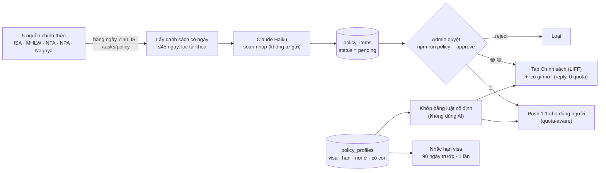
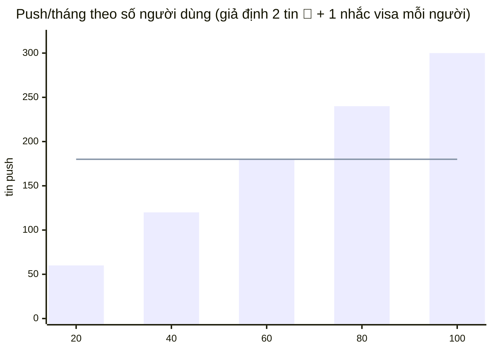

# Bản tin chính sách cá nhân hóa

Không gửi tin chung chung — chỉ báo thay đổi ảnh hưởng tới **chính người đó**, kèm hạn chót, việc cần làm, link nguồn chính thức.

## Luồng



**Nguyên tắc:** AI chỉ *tóm tắt* một trang chính thức. Ai nhận tin nào do **luật cố định** quyết định (`src/server/policy/match.ts`), và không có gì được gửi nếu admin chưa duyệt.

## Ba loại tin

| | Khi nào | Gửi thế nào | Tốn quota push |
|---|---|---|---|
| 🔴 Khẩn | Đã chốt, mốc quan trọng (hạn / hiệu lực) trong ≤30 ngày | Push ngay khi admin duyệt | Có (1/người/tin) |
| 🟡 Sắp có hiệu lực | Đã chốt, còn >30 ngày | Tab "Chính sách" + `có gì mới` | Không |
| 🟢 Đang bàn | Dự thảo / パブコメ | Tab "Chính sách" + `có gì mới` | Không |

Màu chỉ là **gợi ý** (`suggestSeverity`); admin đổi được khi duyệt: `approve <id> --severity red`.

## Ví dụ tin 🔴

```
🔴 Phí gia hạn 在留 tăng
Hạn: … · Áp dụng từ: 1/10/2026
Visa của bạn hết hạn 3/2027 → bạn có thể nộp đơn gia hạn từ 12/2026 — sau ngày áp dụng (1/10/2026) nên sẽ theo quy định mới.
💡 Vì sao bạn nhận tin: Vì visa của bạn hết hạn 3/2027.
✅ Việc cần làm: Chuẩn bị giấy tờ sớm.
🔗 Nguồn: 出入国在留管理庁 …
```

Người có visa hết hạn **trước** ngày áp dụng sẽ **không** nhận tin này (họ nộp theo quy định cũ).

## Quota push LINE (gói free: 200 tin/tháng, dùng chung)

Chỉ có 3 thứ tiêu quota: tin 🔴, nhắc hạn visa (1 lần / mỗi ngày hết hạn), cảnh báo admin. Còn lại đi bằng reply (miễn phí) hoặc LIFF. Luôn giữ lại 20 tin dự phòng; hết quota thì tin 🔴 được hoãn (người dùng vẫn thấy trong app) và admin được báo 1 lần/tháng.



Đường ngang = ngân sách dùng được (200 − 20 dự phòng). Vượt ~60 người dùng thì cần gói trả phí (hoặc chỉ push 🔴 loại nghiêm trọng nhất). `npm run policy -- stats` in ước tính theo số hồ sơ thật.

## Ranh giới pháp lý (đã cài trong code)

- Chỉ nêu thay đổi + việc cần làm chung; prompt cấm đánh giá "bạn có đủ điều kiện 永住 không" (việc của 行政書士).
- Chỉ đọc **trang chính thức** của cơ quan nhà nước, luôn kèm link; không dùng báo chí.
- **Bắt buộc admin duyệt** trước khi bất kỳ ai nhận tin.
- Mọi tin kèm dòng "Tóm tắt từ nguồn chính thức, không phải tư vấn pháp lý".
- Trong **nhóm LINE** bot không in dữ liệu cá nhân (visa, ngày hết hạn): chỉ gửi link mở app.

## Vận hành hằng ngày

```bash
npm run policy -- fetch --dry       # xem link mỗi nguồn trả về (không gọi Claude) — chạy khi nghi nguồn đổi giao diện
npm run policy -- fetch             # (job 7:30 tự chạy) tạo bản nháp, báo admin qua LINE
npm run policy -- list              # bản nháp chờ duyệt
npm run policy -- show <id>         # nội dung, đối tượng, sẽ tới bao nhiêu người
npm run policy -- approve <id>      # 🔴 push ngay nếu có LINE_CHANNEL_ACCESS_TOKEN; không thì job sáng hôm sau gửi
npm run policy -- reject <id>
npm run policy -- stats             # biểu đồ tin / người dùng / quota push
```

Cần `ANTHROPIC_API_KEY` để có bản tóm tắt thật (không có thì dùng bản mẫu để thử luồng). Chi phí ước tính < $0.001 / trang (Haiku), tối đa `POLICY_MAX_NEW_PER_RUN` (10) trang/nguồn/ngày, dùng chung `MONTHLY_BUDGET_USD`.

Đổi/thêm nguồn: sửa `src/server/policy/sources.ts` (URL trang "tin mới", `keywords`, `exclude`). Nguồn thành phố: đặt `city` và thêm vào `POLICY_CITIES`.

## Phạm vi đã làm (MVP) và chưa làm

| Đã có | Chưa có (theo spec gốc) |
|---|---|
| 5 nguồn: 入管庁, 厚労省, 国税庁, 警察庁, Nagoya | Hồ sơ mở rộng (bằng lái, 特定技能/ngành, hợp đồng, kế hoạch 永住) |
| Hồ sơ 3 trường + sửa/xóa trong LIFF | Nhắc 住民税 / hạn bằng lái |
| 🔴 push · 🟡🟢 trong app · `có gì mới` | Chấm đỏ trên rich menu (LINE không đổi được theo người nếu không dùng rich menu riêng; hiện dùng badge số ở tab) |
| Nhắc hạn 在留 trước 3 tháng | Gói Premium / B2B 登録支援機関 |
| Admin duyệt (CLI + API `/api/admin/policy`) | Màn hình duyệt trong LIFF |

## Lưu ý đã kiểm chứng (2026-10-28)

- Danh sách "tin mới" của 5 nguồn đã được đối chiếu với trang thật. 国税庁 trả 0 mục khi không có thông cáo nào trong 45 ngày — bình thường, vì nguồn này ít tin dành cho cư dân.
- Trang ISA chặn User-Agent mặc định của `curl` (403) nhưng chấp nhận bot khai báo đúng tên (`GiayToNhat-PolicyReader`). Không giả User-Agent trình duyệt.
- Bản tóm tắt bằng Claude **chưa được chạy với dữ liệu thật** (thiếu API key trong môi trường phát triển): hãy chạy `fetch` với 10–20 trang thật và đối chiếu ngày/đối tượng trước khi mời người dùng.
